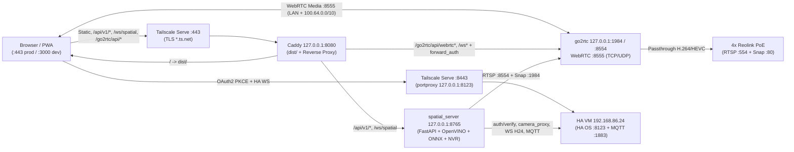

# 🏡 Smart Home 3D — Digital Twin & Spatial CV Engine

> Piattaforma interattiva di domotica e videosorveglianza spaziale basata su **Three.js (PWA)**, **Blender Single Source of Truth (SSoT)**, **Home Assistant** e microservizio Python **`spatial_server`** (Spatial CV $(x,y,z,t)$, biometria Face/ALPR, NVR Dual-Tier, episodi e automazioni).

📚 **Portale Documentazione Completa:** consulta [`docs/INDEX.md`](docs/INDEX.md) per la navigazione Diátaxis completa (architettura, runbook operativi, reference e prompt) e [`PRODUCT.md`](PRODUCT.md) per principi e vincoli di prodotto.

---

## 📐 I Tre Pilastri Architetturali

1. **Blender come Single Source of Truth (SSoT):** nessuna coordinata 3D o posa ottica cablata in JavaScript o Python. Geometrie, entità IoT (`ha_entity`, `ha_action`, `ha_ui_type`), 4 telecamere reali (`Cam_Carraio`, `Cam_Portico`, `Cam_Ingresso`, `Cam_Stradina`) e superfici calpestabili (`collider_role = "ground"`) derivano da [`Smart_Home_3D.blend`](Smart_Home_3D.blend) ed esportano in `public/models/scene_manifest.json` + `public/models/house_optimized.glb` ([guida SSoT](docs/architecture/blender-ssot-pipeline.md)).
2. **Home Assistant Bidirezionale, OAuth2/RBAC & Mock Offline:** sincronizzazione in tempo reale via `home-assistant-js-websocket` con controllo luci, cancelli, TV webOS, lavastoviglie, irrigazione 3-zone, centrale termica e robot Deebot. In produzione usa **OAuth2 PKCE (`:8443`) + cookie `sh3d_session` + `forward_auth`** con separazione ruoli **`Admin` vs `Residente`**; in sviluppo supporta `SH3D_DEV_MODE` e un fallback **Offline Mock/Demo** a zero configurazione ([architettura frontend](docs/architecture/frontend-and-devices.md)).
3. **Motore Spatial CV $(x,y,z,t)$, Biometria, NVR Dual-Tier & Automazioni:** `spatial_server` (`127.0.0.1:8765`) ingerisce substream RTSP via OpenVINO (`YOLOv8n`), eventi MQTT o simulazione sintetica, proietta i bounding box 2D sui ground collider (`PinholeRadTan` / `Equirectangular 180°` + `TrimeshGroundRaycaster`), fonde le tracce multi-camera con filtro di Kalman 3D (`SQLite3 WAL + R-Tree`), esegue riconoscimento volti (`SCRFD` + `MobileFaceNet`/`ResNet50`) e targhe ALPR (`YOLOv9-tiny` + `fast-plate-ocr`), registra in NVR Dual-Tier (`sub` H24 + `main` con pre-roll RAM), aggrega episodi `SceneEvent` e valuta regole spaziali 2.5D ([architettura backend](docs/architecture/spatial-cv-and-biometrics.md)).

---

## 🌐 Topologia di Produzione e Sviluppo

Architettura **100% nativa Windows 10** sul nodo server (`Intel i5-6400 / 8 GB RAM / Intel HD 530`, Zero Docker / Zero WSL2), affiancata dalla VM VirtualBox con Home Assistant OS e Mosquitto MQTT ([dettaglio topologia e porte](docs/architecture/system-overview.md)):



> Nota di sicurezza ([`caddy/Caddyfile`](caddy/Caddyfile)): `/go2rtc/*` e `/go2rtc` restituiscono `403 Forbidden`; solo `/go2rtc/api/webrtc*` e `/go2rtc/api/ws*` sono instradati previa `forward_auth` su `127.0.0.1:8765/api/v1/auth/verify`.

---

## 🚀 Quickstart: Sviluppo Locale vs Produzione Windows 10

Configura le variabili d'ambiente partendo da [`.env.example`](.env.example) (vedi reference completo in [`docs/reference/env-variables.md`](docs/reference/env-variables.md)). **Non committare né leggere mai `.env` in contesti condivisi.**

### Sviluppo Locale (Portatile / Workstation)

```powershell
# 1. Dipendenze frontend (Node.js v18+ / v24 LTS)
npm install

# 2. Provisioning ambiente Python (.venv), binari nativi e modelli AI opzionali
powershell -ExecutionPolicy Bypass -File scripts\setup_windows_node.ps1 -WithOpenVINO -WithBiometrics

# 3. Avvio servizi nativi locali (go2rtc + spatial_server + Caddy se configurato)
scripts\start_services.bat

# 4. Avvio Vite Dev Server (http://localhost:3000, con proxy /api/ha-camera/snapshot)
npm run dev
```

*Senza servizi avviati o `.env` configurato, il frontend entra in **Modalità Demo Mock** su `http://localhost:3000` (con `SH3D_DEV_MODE=true` solo in locale).*

### Produzione Windows 10 (PC Fisso + Tailscale Serve + NSSM)

Segui la procedura completa in [`docs/runbooks/production-tailscale.md`](docs/runbooks/production-tailscale.md) e [`scripts/README.md`](scripts/README.md):

```powershell
# 1. Build PWA statica (azzera sempre VITE_HA_TOKEN e gli override dev)
npm run build

# 2. Setup completo + registrazione servizi NSSM (SmartHome3D-go2rtc, SpatialServer, Caddy) + Firewall :8555
powershell -ExecutionPolicy Bypass -File scripts\setup_windows_node.ps1 -WithOpenVINO -WithBiometrics -InstallServices -LanCidr 192.168.86.0/24
```

Per aggiornare un nodo già in produzione dopo `git push`: esegui `scripts\update_services.bat` da Amministratore. Per eseguire la suite di test (298 item `pytest` + helper Node.js), vedi [`docs/reference/testing-suite.md`](docs/reference/testing-suite.md):

```powershell
.\.venv\Scripts\python.exe -m pytest tests/e2e spatial_server/tests -v
```

---

## 🛠️ Pipeline Blender -> Web & Comandi `npm`

Definiti in [`package.json`](package.json) (i comandi Blender invocano Blender 5.2 in modalità headless su [`Smart_Home_3D.blend`](Smart_Home_3D.blend)):

| Comando `npm` | Descrizione |
|---|---|
| `npm run setup:props` | Applica in modo idempotente `GROUND_COLLIDERS`, `ENTITY_MAPPINGS`, aperture e le 4 camere reali su `Smart_Home_3D.blend` |
| `npm run export:blend` | Calibra i materiali PBR ed esporta `public/models/house_raw.glb` + `public/models/scene_manifest.json` |
| `npm run optimize:glb` | Ottimizza e comprime il `.glb` (`dedup`, `prune`, `weld`) tramite `tools/optimize_glb.mjs` in `public/models/house_optimized.glb` |
| `npm run build:model` | Esegue in sequenza `export:blend` e `optimize:glb` |
| `npm run dev` | Avvia Vite dev server (`vite`) su porta `3000` |
| `npm run build` | Compila la PWA di produzione (`vite build` in `dist/`, azzerando sempre le variabili dev) |
| `npm run preview` | Avvia l'anteprima locale della build `dist/` (`vite preview`) |

---

## 📂 Mappa del Repository e Guide per Servizio

| Area / Cartella | Contenuto Principale | Guida Locale |
|---|---|---|
| [`src/`](src/README.md) | Frontend Three.js, 6 controller smart device, Spatial CV UI, Video/NVR, PWA Shell | [`src/README.md`](src/README.md) |
| [`spatial_server/`](spatial_server/README.md) | Microservizio FastAPI (55 endpoint REST, `/ws/spatial`, OpenVINO, Biometria, NVR, Automazioni, Auth) | [`spatial_server/README.md`](spatial_server/README.md) |
| [`blender/`](blender/README.md) | Script `bpy` SSoT (`setup_ha_properties.py`, `add_user_devices.py`, `export_glb.py`) | [`blender/README.md`](blender/README.md) |
| [`scripts/`](scripts/README.md) | Script Windows `.ps1`/`.bat` (setup, NSSM, Firewall `:8555`, update, decommission CodeProject.AI) | [`scripts/README.md`](scripts/README.md) |
| [`caddy/`](caddy/README.md) | `Caddyfile` reverse proxy `:8080`, static PWA serving e `forward_auth` su `go2rtc` | [`caddy/README.md`](caddy/README.md) |
| [`go2rtc/`](go2rtc/README.md) | `go2rtc.yaml` passthrough RTSP/WebRTC/MSE/Snapshot (16 stream per 4 telecamere Reolink) | [`go2rtc/README.md`](go2rtc/README.md) |
| [`homeassistant/`](homeassistant/README.md) | `automations.yaml`, `trusted_proxies`, bridge `:8443`, OAuth2 e integrazione VM HA | [`homeassistant/README.md`](homeassistant/README.md) |
| [`tools/`](tools/README.md) | Ottimizzatore GLB, download/benchmark AI, discovery/mapping HA, utility audit Blender | [`tools/README.md`](tools/README.md) |
| [`tools/ha_custom_component/`](tools/ha_custom_component/README_MQTT_BRIDGE.md) | Custom component `ecovacs_mqtt_bridge` per telemetria pose Deebot su MQTT | [`README_MQTT_BRIDGE.md`](tools/ha_custom_component/README_MQTT_BRIDGE.md) |
| [`docs/`](docs/INDEX.md) | Documentazione strutturata (Architettura, Runbook, Reference, Prompt) | [`docs/INDEX.md`](docs/INDEX.md) |
| [`tests/`](docs/reference/testing-suite.md) | Suite E2E `tests/e2e/` (`F1`–`F19`, Tier 3/4) e test unitari `spatial_server/tests/` | [`testing-suite.md`](docs/reference/testing-suite.md) |
| [`PRODUCT.md`](PRODUCT.md) | Definizione di prodotto, principi SSoT, brand asset e vincoli UX in italiano | [`PRODUCT.md`](PRODUCT.md) |
