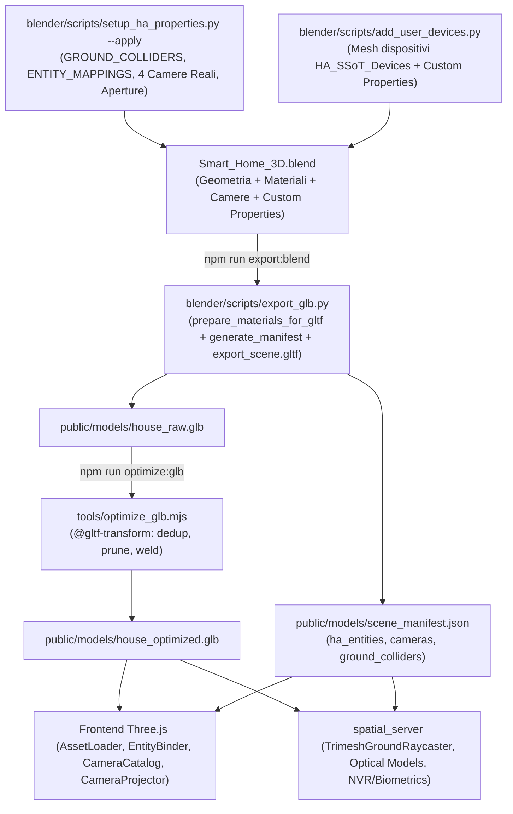

# Pipeline Blender Single Source of Truth (SSoT)

In **Smart_Home_3D**, il file [Smart_Home_3D.blend](../../Smart_Home_3D.blend) costituisce l'unica fonte di verità (**SSoT — Single Source of Truth**) per la geometria architettonica, gli arredi, le telecamere fisiche, i collider di calpestio e il binding verso Home Assistant. Nessuna coordinata di telecamera o dispositivo va duplicata manualmente nel frontend JavaScript o nel backend Python: tutto viene estratto automaticamente in `public/models/scene_manifest.json` e `public/models/house_optimized.glb`.

---

## 1. Flusso End-to-End della Pipeline SSoT



### Comandi `npm` della Pipeline ([package.json](../../package.json))

| Script `npm` | Comando Eseguito | Funzione |
|---|---|---|
| `npm run setup:props` | `'C:\Program Files\Blender Foundation\Blender 5.2\blender.exe' -b Smart_Home_3D.blend -P blender/scripts/setup_ha_properties.py -- --apply` | Applica in modalità headless `GROUND_COLLIDERS`, `ENTITY_MAPPINGS`, aperture aggiornate e le 4 telecamere reali su `Smart_Home_3D.blend`, poi salva il `.blend`. |
| `npm run export:blend` | `'C:\Program Files\Blender Foundation\Blender 5.2\blender.exe' -b Smart_Home_3D.blend -P blender/scripts/export_glb.py -- public/models/house_raw.glb public/models/scene_manifest.json` | Calibra i materiali PBR per glTF, genera `scene_manifest.json` ed esporta `house_raw.glb`. |
| `npm run optimize:glb` | `node tools/optimize_glb.mjs` | Comprime/ottimizza `house_raw.glb` in `house_optimized.glb` preservando nomi dei nodi e `userData`. |
| `npm run build:model` | `npm run export:blend && npm run optimize:glb` | Rigenera in un solo comando sia il manifest sia il `.glb` ottimizzato pronto per Three.js e `spatial_server`. |

---

## 2. Script nella Directory `blender/scripts/`

### 2.1 [blender/scripts/export_glb.py](../../blender/scripts/export_glb.py)
Script di esportazione headless eseguito dentro Blender (`bpy`, `mathutils`). Svolge tre compiti principali in `main()`:

1. **`prepare_materials_for_gltf()`**:
   - Risolve il problema delle mesh bianche in glTF scollegando i nodi procedurali Blender non supportati (`ColorRamp`, texture procedurali ecc., preservando invece i nodi `TEX_IMAGE`) dall'input `Base Color` e `Roughness` del nodo `Principled BSDF`.
   - Applica la mappa `MATERIAL_COLOR_OVERRIDES` (34 materiali calibrati, da `Mat_Prato_Fotorealistico` e `Mat_Parquet_Rovere_PBR` fino a `Mat_Deebot_*` e `Mat_Security_Cam_White`), imposta roughness realistiche per prato/parquet/laccato/intonaci e azzera `Emission Strength` su `Mat_Laccato_Bianco`.
2. **`generate_manifest(manifest_path)`**:
   - Scansiona tutti gli oggetti con `ha_entity` o `ha_alt_entity`, calcola il centroide world-space (`get_world_centroid`) e le dimensioni, e popola `ha_entities` convertendo le coordinate sia in spazio Blender (`+Z Up, +Y North`) sia in spazio glTF/Three.js (`blender_to_gltf_coords(v) = [v[0], v[2], -v[1]]`).
   - Scansiona tutte le `CAMERA` (`extract_camera_data`) estraendo intrinseci ottici (`lens_mm`, `sensor_width_mm`, `sensor_height_mm`, `fov_v_deg`, `fov_h_deg`, `aspect_ratio`, `clip_near`, `clip_far`), distorsione (`distortion_coeffs`), modello ottico e matrici di trasformazione `blender_transform` e `gltf_transform` (`matrix_world_gl` ed `extrinsic_cv_to_world`).
   - Scansiona tutti gli oggetti con `collider_role == "ground"` popolando `ground_colliders`.
3. **`export_glb(output_glb_path)`**:
   - Invoca `bpy.ops.export_scene.gltf` con parametri fissi critici:
     - `export_format="GLB"`
     - `export_extras=True` *(obbligatorio: esporta le Custom Properties di Blender nel `userData` Three.js)*
     - `export_cameras=True`
     - `export_lights=False` *(evita di importare in Three.js la luce solare fisica da `2868 lux` che brucerebbe i materiali)*
     - `export_apply=True`
     - `export_yup=True`

### 2.2 [blender/scripts/setup_ha_properties.py](../../blender/scripts/setup_ha_properties.py)
Configura in modo idempotente le proprietà SSoT, le aperture edilizie calibrate da rilievi reali e le telecamere di sicurezza reali dentro `Smart_Home_3D.blend`:

- **`GROUND_COLLIDERS`** (20 oggetti):
  - *Aree esterne (10):* `Driveway_Gravel`, `Giardino_Area_1_Prato`, `Giardino_Area_2_Prato`, `Giardino_Area_3A_Prato`, `Giardino_Area_3B_Prato`, `Giardino_Area_3C_Prato`, `Portico_Pavement_Unified`, `Terrazza_All_Aperto`, `Walkway_Pedestrian_Pavement`, `Site_Foundation_Earth`.
  - *Pavimenti interni (10):* `Floor_Salotto`, `Floor_Dining_Main`, `Floor_Dining_NorthWing`, `Floor_Dining_Passage`, `Floor_Bagno`, `Floor_Antibagno`, `Floor_Lavanderia`, `Floor_Garage_Main`, `Floor_Garage_EastStair`, `Floor_Garage_WestStair`.
- **`ENTITY_MAPPINGS`**: mappa tutte le mesh interattive alle entità reali di Home Assistant:
  - Illuminazione interna/esterna (`light.forno`, `light.bancone`, `light.1`, `light.2`, `light.smart_plug_in_unit_switch_3`, `light.luci_esterne`, `light.portico`).
  - Cancelli e accessi (`switch.switch_casa_interruttore_1`, `switch.switch_casa_interruttore_2`, `switch.switch_casa_interruttore_3`, ante `Gate_Leaf_L` / `Gate_Leaf_R`).
  - Elettrodomestici e media (`sensor.lavastoviglie_stato_di_funzionamento`, `media_player.smart_tv_lg_oled_2`, `vacuum.deebot`).
  - Centrale termica in lavanderia (`sensor.temperatura_accumulo_alto`, `sensor.temperatura_accumulo_basso`, `sensor.temperatura_caldaia`, `switch.smart_switch_caldaia`).
  - 11 irrigatori da giardino (`Sprinkler_Area1_1..4`, `Sprinkler_Area2_1..2`, `Sprinkler_Area3_1..5` + `_Base`/`_Nozzle`) legati a `switch.smart_switch_area1..3`.
- **`setup_real_security_cameras()`** (`SECURITY_CAMERA_NAMES = {"Cam_Carraio", "Cam_Portico", "Cam_Ingresso", "Cam_Stradina"}`):
  - Costruisce/aggiorna nella collezione `08_Luci_e_Camere` le mesh fisiche (palo/corpo/staffa posizionati dietro il punto ottico per evitare auto-occlusione POV) e i nodi camera ottici con parametri reali:
    - `Cam_Carraio`: Reolink RLC-540A (`192.168.86.47`, `pinhole_radtan`, `4.0 mm`, FOV `80° x 42°`, `carraio_main` / `carraio_sub`).
    - `Cam_Portico`: Reolink RLC-810A (`192.168.86.51`, `pinhole_radtan`, `4.0 mm`, FOV `87° x 44°`, `portico_main` / `portico_sub`).
    - `Cam_Ingresso`: Reolink Duo 3 PoE (`192.168.86.53`, `equirectangular_180`, `is_panoramic_180=True`, `2.8 mm`, FOV `180° x 55°`, aspect `32:9`, `ingresso_main` / `ingresso_sub`).
    - `Cam_Stradina`: Reolink Duo 3 PoE (`192.168.86.55`, `equirectangular_180`, `is_panoramic_180=True`, `2.8 mm`, FOV `180° x 55°`, aspect `32:9`, `stradina_main` / `stradina_sub`).
  - Rimuove inoltre `ha_camera_entity` / `ha_label` da eventuali camere di preview non appartenenti a `SECURITY_CAMERA_NAMES`.
- **`setup_dining_south_wall_openings()` e `setup_salotto_south_door()`**: allineano i prismi a 8 vertici delle pareti sud sala da pranzo/cucina e porta sud salotto alle quote metriche rilevate.

### 2.3 [blender/scripts/add_user_devices.py](../../blender/scripts/add_user_devices.py)
Script procedurale di creazione/rigenerazione della collezione `HA_SSoT_Devices` e delle relative mesh fisiche:
- Ripulisce in ingresso eventuali oggetti precedenti con prefisso noto (`clear_previous_user_devices()`).
- Ridimensiona i muretti del box doccia in lavanderia (`Wall_Lav_Part_V1`, `Wall_Lav_Part_H1`, `Wall_Lav_Part_V2`).
- Crea/aggiorna applique salotto (`light.1`, `light.2`), luci portico (`light.portico`), 4 lampioncini bollard + 4 applique muro giardino (`light.luci_esterne`), centrale termica in lavanderia (puffer `Thermal_Puffer_*` + sensori `Sensor_Puffer_High`/`Low`, caldaia `Thermal_Caldaia_*` + `Sensor_Caldaia_Temp` + `Switch_Caldaia_Wall`), switch cancelli/garage, lavastoviglie, `Cam_Carraio` (con `ha_alt_entity = "camera.carraio_trasparente"`) e gli 11 irrigatori (`Sprinkler_Area1..3`) completi di `_Base`, stelo e `_Nozzle`.

---

## 3. Script Scene Builder Storici (`archive/`)

In `archive/` risiedono i 5 script storici di generazione e rifinitura architettonica del modello 3D (precedentemente nella root):

| Script | Righe | Scopo Principale | Note Operative |
|---|---|---|---|
| [archive/build_clean_scene_v2.py](../../archive/build_clean_scene_v2.py) | 1160 | Generatore architetturale completo da zero (terreni watertight, garage con rampa/scale interrate, edificio residenziale, recinzioni, materiali PBR procedurali, camere Revit). | **Protezione attiva:** solleva `RuntimeError("SAFETY ABORT...")` se la scena contiene già oggetti a meno di passare `--force-rebuild-all`. |
| [archive/add_main_furniture.py](../../archive/add_main_furniture.py) | 806 | Aggiunge struttura principale degli arredi di cucina ad L, sala da pranzo (tavolo ruotato 90° Nord-Sud, vetrinetta, Kallax) e salotto. | Script di costruzione arredi principale. |
| [archive/create_salotto_refined.py](../../archive/create_salotto_refined.py) | 1038 | Rifinitura v4 del salotto e zona pranzo (tavolo live-edge 2.65×1.05 m con 8 sedie orientate, mobile TV lowboard + TV 65", termosifone su parete sud, parete a 45° NW e stufa a legna con canna fumaria). | Opera su collezione `09_Arredi_Principali` e `08_Luci_e_Camere`. |
| [archive/update_kitchen_refined.py](../../archive/update_kitchen_refined.py) | 598 | Rifinitura fotorealistica dell'angolo cucina (basi a 90° con paraste, top travertino con smusso a 45°, piano cottura ad angolo con griglie a ragno, paraschizzi ad arco, cappa angolare, mensole e accessori). | Opera su collezione `09_Arredi_Principali`. |
| [archive/update_stairs_and_walkway.py](../../archive/update_stairs_and_walkway.py) | 563 | Corregge la compenetrazione delle scale sul vano scala, modella pianerottolo curvo con porta vetrata, panca in muratura e caminetto d'angolo, cancelletto pedonale e vialetto. | Allinea scale interne ed esterni pedonali. |

> [!WARNING]
> Non eseguire `build_clean_scene_v2.py --force-rebuild-all` su `Smart_Home_3D.blend` a meno di voler azzerare tutte le rifiniture successive; per aggiornamenti incrementali di dispositivi e proprietà usa `blender/scripts/setup_ha_properties.py` o gli script mirati in `tools/`.

---

## 4. Contratto delle Custom Properties Blender (`userData`)

Tutte le Custom Properties assegnate sugli oggetti Blender vengono esportate in `house_raw.glb`/`house_optimized.glb` come `mesh.userData` (grazie a `export_extras=True`) e nel manifest `scene_manifest.json`.

### 4.1 Proprietà per Dispositivi e Collider
| Chiave | Applicata a | Valori Osservati | Utilizzo |
|---|---|---|---|
| `ha_entity` | Mesh interattive e telecamere | Entity ID HA (es. `light.forno`, `switch.switch_casa_interruttore_1`, `vacuum.deebot`, `sensor.temperatura_caldaia`, `camera.portico`) | Identificativo primario per `EntityBinder`, `InteractionManager` e `DeviceRegistry`. |
| `ha_alt_entity` | `Cam_Carraio` (in `add_user_devices.py`) | `camera.carraio_trasparente` | Entità secondaria associata allo stesso oggetto nel manifest (`ha_entities`). |
| `ha_action` | Mesh interattive | `toggle`, `modal`, `stream` | Azione scatenata al click nella scena 3D. |
| `ha_ui_type` | Mesh interattive | `light_emissive`, `light`, `sliding_gate`, `dishwasher`, `tv_display`, `tv_frame`, `switch`, `sensor`, `vacuum`, `irrigation`, `camera`, `default` | Seleziona il controller/shader UI in `EntityBinder` e `DeviceRegistry`. |
| `ha_name` | Mesh interattive | Stringa descrittiva (es. `"Cancello Carraio"`, `"Smart TV LG OLED"`) | Etichetta mostrata in tooltip, badge e modali. |
| `ha_badge_style` | Sensori termici | `puffer_high`, `puffer_low`, `caldaia` | Seleziona stile visivo dei badge CSS2D della centrale termica. |
| `ha_area`, `ha_riser_height` | Irrigatori `Sprinkler_Area*` | `"Area 1"`..`"Area 3"`, `0.25` | Area e corsa pop-up dell'irrigatore per animazioni `IrrigationController`. |
| `collider_role` | Superfici calpestabili (20 oggetti) | `"ground"` | Identifica le mesh esportate in `ground_colliders` usate da `TrimeshGroundRaycaster` e dal raycasting copertura camere. |

### 4.2 Proprietà Ottiche e di Streaming per Telecamere (`CAMERA`)
| Chiave | Tipo / Valori Osservati | Scopo |
|---|---|---|
| `ha_camera_entity` | Stringa (es. `camera.carraio_scorrevole`, `camera.portico`, `camera.ingresso`, `camera.stradina`) | Marca la camera come **telecamera di sicurezza reale** (`is_real_security_camera: true`), distinguendola dalle 26 camere di preview/Revit. |
| `ha_label` | Stringa (es. `"Portico (Reolink RLC-810A)"`) | Etichetta canonica usata in `CameraCatalog` e nell'interfaccia Sicurezza. |
| `camera_model` | Stringa (es. `"Reolink RLC-540A"`, `"Reolink RLC-810A"`, `"Reolink Duo 3 PoE"`) | Modello hardware mostrato in diagnostica e overlay. |
| `coverage_zone` | Stringa (es. `"outdoor_gates_street"`, `"Portico"`, `"zona ovest della casa"`, `"zona nord della casa"`) | Zona di copertura logica. |
| `optical_model` | `"pinhole_radtan"` \| `"equirectangular_180"` | Seleziona il modello ottico in `spatial_server/optics/` (`PinholeRadTanOpticalModel` vs `EquirectangularPanoramicOpticalModel`) e in `CameraProjector.js`. |
| `is_panoramic_180` | Booleano (`True` su `Cam_Ingresso` e `Cam_Stradina`) | Abilita proiezione panoramica 180° (32:9) e gestione dedicata in frustum/snapshot/biometria. |
| `fov_h_deg`, `fov_v_deg`, `aspect_ratio` | Float (es. `80.0 / 42.0 / 1.7778` oppure `180.0 / 55.0 / 3.5556`) | Override espliciti di FOV orizzontale/verticale e aspect ratio (necessari soprattutto per le Duo 3 PoE panoramiche). |
| `distortion_coeffs` | Array 5 float `[k1, k2, p1, p2, k3]` (es. `[-0.18, 0.04, 0.0, 0.0, 0.0]`) | Coefficienti distorsione radiale/tangenziale Brown-Conrady. |
| `stream_id`, `sub_stream_id` | Stringhe (es. `carraio_main`, `carraio_sub`) | Identificativi stream su `go2rtc/go2rtc.yaml`. |
| `main_stream_label`, `sub_stream_label` | Stringhe (es. `"Main 5MP"`, `"Main 4K"`, `"Main 16MP 180°"`, `"Sub 640×360"`, `"Sub 1536×576"`) | Etichette qualità nel selettore player UI. |
| `camera_ip` | IPv4 LAN (es. `"192.168.86.47"`) | Indirizzo IP diagnostico e per provisioning/NVR. |

---

## 5. Schema di [public/models/scene_manifest.json](../../public/models/scene_manifest.json)

Il file generato da `export_glb.py` contiene attualmente **24** entità HA, **30** camere totali (**4** telecamere di sicurezza reali + 26 viste statiche/Revit) e **20** ground collider, con questa struttura JSON:

```json
{
  "generator": "export_glb.py (Blender SSoT Pipeline)",
  "blender_version": "5.2.3 LTS",
  "scene_name": "Scene",
  "unit_system": "METRIC",
  "ha_entities": {
    "light.1": {
      "entity_id": "light.1",
      "domain": "light",
      "name": "Applique Salotto Est",
      "action": "toggle",
      "ui_type": "light_emissive",
      "badge_style": "",
      "objects": [
        {
          "object_name": "Applique_Salotto_Est",
          "type": "MESH",
          "centroid": [6.03, -2.2, 1.95],
          "dimensions": [0.08, 0.12, 0.28],
          "badge_style": ""
        }
      ],
      "centroid_blender": [6.03, -2.2, 1.95],
      "centroid_gltf": [6.03, 1.95, 2.2]
    }
  },
  "cameras": {
    "Cam_Carraio": {
      "name": "Cam_Carraio",
      "ha_camera_entity": "camera.carraio_scorrevole",
      "ha_label": "Telecamera Carraio (Reolink RLC-540A)",
      "coverage_zone": "outdoor_gates_street",
      "is_real_security_camera": true,
      "optical_model": "pinhole_radtan",
      "distortion_coeffs": [-0.18, 0.04, 0.0, 0.0, 0.0],
      "stream_id": "carraio_main",
      "sub_stream_id": "carraio_sub",
      "camera_ip": "192.168.86.47",
      "lens_mm": 4.0,
      "sensor_width_mm": 6.7128,
      "sensor_height_mm": 3.0695,
      "fov_v_deg": 42.0,
      "fov_h_deg": 80.0,
      "aspect_ratio": 1.7778,
      "clip_near": 0.1,
      "clip_far": 250.0,
      "blender_transform": {
        "position": [-11.29, -6.28, 1.68],
        "quaternion": [0.62932, 0.0, 0.0, 0.77715],
        "rotation_euler_deg": [78.0, 0.0, 0.0],
        "matrix_world": [1.0, "... 16 float row-major ..."]
      },
      "gltf_transform": {
        "position": [-11.29, 1.68, 6.28],
        "matrix_world_gl": ["... 16 float ..."],
        "extrinsic_cv_to_world": ["... 16 float ..."]
      },
      "camera_model": "Reolink RLC-540A",
      "main_stream_label": "Main 5MP",
      "sub_stream_label": "Sub 640×360"
    }
  },
  "ground_colliders": [
    {
      "object_name": "Driveway_Gravel",
      "centroid": [-4.72, -15.655, -0.025],
      "dimensions": [20.62, 14.75, 0.05]
    }
  ]
}
```

### Convenzione di Cambio Base (`export_glb.py`)
- **Blender World** (`+X` Est, `+Y` Nord, `+Z` Alto) -> **glTF / Three.js World** (`+X` Est, `+Y` Alto, `+Z` Sud): matrice `C_w_b`.
- **OpenCV Camera Local** (`+X` destra, `+Y` basso, `+Z` avanti) -> **OpenGL/Blender Camera Local** (`+X` destra, `+Y` alto, `-Z` avanti): matrice `S_gl_cv`.
- **`extrinsic_cv_to_world = C_w_b @ matrix_world @ S_gl_cv`**: usata direttamente sia da Three.js sia da `spatial_server` (`solvePnPRansac` e raycasting).

---

## 6. Ottimizzazione GLB (`tools/optimize_glb.mjs`)

Lo script [tools/optimize_glb.mjs](../../tools/optimize_glb.mjs) legge `public/models/house_raw.glb` e produce `public/models/house_optimized.glb` usando `@gltf-transform/core` (`NodeIO`), `@gltf-transform/extensions` (`KHRONOS_EXTENSIONS`) e `@gltf-transform/functions`:

```js
await document.transform(
  dedup(),
  prune({ keepAttributes: true, keepLeaves: true }),
  weld()
);
```

- **`dedup()`**: deduplica accessori, materiali e mesh identiche riducendo la dimensione del file senza toccare la gerarchia logica.
- **`prune({ keepAttributes: true, keepLeaves: true })`**: rimuove risorse orfane preservando esplicitamente attributi geometrici e nodi foglia (essenziale per non eliminare mesh vuote o marker con `userData`).
- **`weld()`**: salda vertici duplicati adiacenti sulle mesh.
- **Fallback resiliente**: se `@gltf-transform` non fosse disponibile, lo script copia direttamente `house_raw.glb` in `house_optimized.glb` senza bloccare la build.
- **Versioning deterministico PWA**: `AssetLoader.js` calcola l'URL di `house_optimized.glb?v=<hash>` dal contenuto di `scene_manifest.json` (`NetworkFirst`), permettendo al Service Worker Workbox di servire il `.glb` in `CacheFirst` (30 giorni) invalidando la cache solo a fronte di una nuova esportazione del modello.

---

## Riferimenti Correlati
- Guida locale Blender: [blender/README.md](../../blender/README.md)
- Procedura aggiunta nuova telecamera: [add-camera.md](../runbooks/add-camera.md)
- Catalogo completo script ausiliari: [tools/README.md](../../tools/README.md)
- Strategia cache `.glb` e test automatici: [testing-suite.md](../reference/testing-suite.md)
