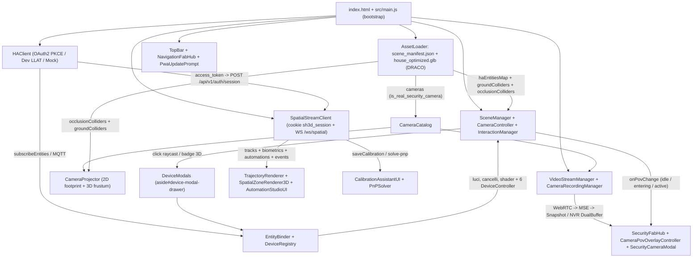

# Architettura Frontend e Dispositivi Smart (`src/`)

Documentazione tecnica esaustiva dell'applicazione frontend **Smart Home 3D**: motore grafico **Three.js**, integrazione **Home Assistant**, ecosistema dei 6 controller **Smart Devices**, layer **Spatial CV & Calibrazione PnP**, pipeline **Video & Replay NVR**, **UI Shell Material 3** e configurazione **PWA / Vite**.

Per una guida rapida orientata allo sviluppo quotidiano e all'estensione con nuovi dispositivi, consulta [`src/README.md`](../../src/README.md).

---

## Panoramica Architetturale e Flusso Dati

---

## 1. Core 3D Engine (`src/core/*`)

### [`SceneManager.js`](../../src/core/SceneManager.js)
Gestisce il renderer WebGL, il renderer HTML sovrapposto `CSS2DRenderer`, il ciclo `requestAnimationFrame` e il budgeting energetico/GPU:

- **Camera e Renderer**: `THREE.PerspectiveCamera(45, width / height, 0.1, 1000)` posizionata inizialmente a `(23, 18, 25)` verso l'origine; `WebGLRenderer({ antialias: true, powerPreference: 'high-performance' })` con `PCFSoftShadowMap`, `THREE.SRGBColorSpace` e `THREE.ACESFilmicToneMapping`.
- **Profilo Mobile vs Desktop (`detectMobileTouchProfile`)**: riconosce i dispositivi touch/compatti tramite `(pointer: coarse)`, `innerWidth <= 900` oppure `hasTouch && !isFinePointer`, evitando falsi positivi sui laptop touchscreen con mouse/trackpad. Sui dispositivi mobili:
  - limita `devicePixelRatio` a `1.5` (contro `2.0` su desktop);
  - imposta `shadowMap.autoUpdate = false` con aggiornamento on-demand tramite `markShadowsDirty()`;
  - riduce la risoluzione della shadow map direzionale da `2048x2048` a `1024x1024`.
- **Illuminazione Giorno / Notte (`setupLighting`, `setNightMode`)**:
  - **Giorno** (default): sfondo `blenderBgColor` (`0x393c40`), `AmbientLight` bianca (`0.75`), `HemisphereLight` (`0xf1f5f9` / `0x64748b`, intensità `0.65`), `DirectionalLight` solare (`0xfffdf5`, intensità `1.4`, frustum ombre `±32 m`), `fillLight` fredda (`0xdbeafe`, `0.55`), `toneMappingExposure = 1.15`.
  - **Notte** (`setNightMode(true)`): sfondo `0x060a12`, `ambientLight` azzurrata (`0x38bdf8`, intensità `0.12`), `hemiLight` attenuata (`0.08`, colori invariati `0xf1f5f9` / `0x64748b`), `sunLight` lunare (`0x60a5fa`, intensità `0.20`), `fillLight` ridotta a `0.05`, `toneMappingExposure = 1.25` per esaltare le luci dinamiche interne/giardino.
- **Gestione `visibilitychange` e Telemetria**: quando il tab/PWA va in background (`document.hidden`), annulla `animationFrameId`; al ritorno riallinea `THREE.Clock` (`getDelta()`) per impedire salti nelle animazioni dei cancelli o del Deebot. `getPerfStats()` espone FPS, `renderer.info.render.calls`, `triangles`, DPR effettivo, `isMobileProfile` e nome del renderer `WEBGL_debug_renderer_info` (consumati in [`TopBar`](../../src/ui/TopBar.js)).

### [`AssetLoader.js`](../../src/core/AssetLoader.js)
Carica il modello ottimizzato esportato dalla pipeline Blender e ne ricostruisce semantica e collider:

- **Cache-busting & Loader**: `loadManifest('/models/scene_manifest.json')` esegue `fetch(..., { cache: 'no-store' })` e calcola un hash **FNV-1a** dei campi principali (`manifestVersion`) usato come query `?v=<hash>` per caricare `/models/house_optimized.glb` (con fallback automatico su `/models/house_raw.glb`). Decodifica mesh compresse via `DRACOLoader` puntando al decoder versionato `1.5.7` (`https://www.gstatic.com/draco/versioned/decoders/1.5.7/`).
- **Materiali PBR e Texture Procedurali 512x512**: genera al volo `CanvasTexture` tileabili per `parquet`, `grass`, `stone` e `gravel` (sfruttando `ensurePlanarUVs` per le geometrie prive di UV, saltando `TV_Salotto` e `Screen`), rimuove eventuali luci incorporate nel GLB e applica materiali condivisi memorizzati in `sharedMaterials` per tutti i materiali Blender standard (`Mat_Prato_Render`, `Mat_Parquet_Render`, `Mat_Lastricato_Render`, `Mat_Ghiaia_Render`, `Mat_Cemento_Render`, `Mat_Earth_Render`, `Mat_Muri_Esterni`, `Mat_Muri_Interni`, `Mat_Infissi_Render`, `Mat_Cordolo_Render`, `Mat_Vetro_Render`, `Mat_Vetro_Nero_Display_Opaque`, `Mat_Macchina_Caffe_Opaque`, `Mat_Metallo_Cancello`, `Mat_Lavastoviglie_Vasca_Inox`, `Mat_Legno_Arredi`, `Mat_Laccato_Bianco_Soft`, `Mat_Diffusore_Isola`, `Mat_Label_Blueprint`).
- **Indici Semantici e Collider**:
  - `haEntitiesMap`: mappa `entity_id -> Mesh[]` leggendo `userData.ha_entity` e `userData.ha_alt_entity` (con duplicazione automatica dell'alias TV `media_player.lg_webos_smart_tv` ↔ `media_player.smart_tv_lg_oled_2`).
  - `groundColliders`: mesh di pavimentazione/terreno identificate tramite `userData.collider_role === 'ground'`, `groundNamesFromManifest`, prefissi `Floor_` / `Giardino_` o nomi esatti `Driveway_Gravel`, `Portico_Pavement_Unified`, `Terrazza_All_Aperto`, `Walkway_Pedestrian_Pavement`.
  - `occlusionColliders`: bounding box mondiali (`THREE.Box3`) per elementi con altezza `> 0.05 m` identificati da prefissi `Wall_`, `Muro_`, `Pillar_`, `Beam_Portico_`, `Garage_Door_Panel_`, `Door_`, `Gate_Pillar_`, `Gate_Ped_Pillar_`, nome `Gate_Central_Low_Wall` oppure sottostringhe materiale `Esterno_Dark`, `Interno_Light`, `Muri_Esterni`, `Muri_Interni` (escludendo luci, vetri, recinzioni `Fence_*` e camere), usate da `CameraProjector` per le occlusioni.
- **Ottimizzazione Draw Call (`batchStaticMeshes`)**: fonde tramite `mergeGeometries` le mesh statiche che condividono lo stesso materiale ed esclude rigorosamente qualsiasi oggetto con `userData.ha_entity`, nodi parent protetti o prefissi dinamici: `Gate_`, `Switch_Gate`, `Garage_Door_Panel_`, `Lavastoviglie`, `TV_Salotto`, `Sprinkler_`, `Ecovacs_Deebot_`, `Security_Cam_`, `Bollard_Garden_`, `Wall_Garden_Light_`, `Puffer`, `Caldaia`, `Accumulo`, `Screen`.

### [`CameraController.js`](../../src/core/CameraController.js)
Controlla la navigazione orbitale (`OrbitControls` con `enableDamping`, `dampingFactor: 0.05`, `maxPolarAngle: Math.PI / 2 - 0.02`, `minDistance: 0.8`, `maxDistance: 160.0`):

- **Preset Desktop (`presets`) e Portrait Mobile (`mobilePresets`)**: fornisce 17 viste nominate (12 scene + 5 `device_*`: `overview`, `gate`, `carraio_cam`, `living`, `dining`, `kitchen`, `laundry`, `garden`, `irrigation_area1`, `irrigation_area2`, `irrigation_area3`, `topdown`, `device_thermal`, `device_irrigation`, `device_tv`, `device_dishwasher`, `device_deebot`). Quando `isPortraitViewport()` (`width / height < 0.85`) è vero, applica gli offset calibrati per smartphone in `mobilePresets`.
- **Transizioni e Tracking**: `flyTo(presetOrConfig)` usa un easing cubico `smoothstep`; `startFollowing()` / `stopFollowing()` consentono di ancorare dinamicamente il target orbitale al robot aspirapolvere in movimento; `setInstantCameraPose()` aggiorna istantaneamente la vista durante lo scrub degli slider di calibrazione.
- **Modalità Camera POV (`flyToCameraPOV` / `exitCameraPOV`)**: posiziona la camera Three.js esattamente al centro ottico `position` della telecamera reale (`0 m` di offset) mirando a un punto lungo il raggio ottico a `12 m`, notificando lo stato (`'idle' | 'entering' | 'active'`) tramite `onPovChange`. Ogni input utente (`wheel`, pinch `touchstart` o drag `> 5 px`, o deriva posa `> 0.002`) fa uscire automaticamente dal POV a meno che non sia attivo `setPovExitLocked(true)` (usato durante il picking dei punti PnP).

### [`InteractionManager.js`](../../src/core/InteractionManager.js)
Gestisce il puntamento 3D unificato mouse + touch, i badge 2D e i pannelli termici immersivi:

- **Raycasting & Hover**: ignora gesture multi-touch (`_wasMultiTouch`) e drag superiori a `10 px`. Su desktop (`!isMobileProfile`) evidenzia la mesh interagibile clonandone temporaneamente il materiale ed elevandone `emissive` a `0x38bdf8`. La risalita gerarchica (`findInteractableTarget`) cerca `userData.ha_entity` risalendo fino a 4 parent, con auto-rilevamento dei nomi `Sprinkler_Area1..3`.
- **Instradamento Click (`handleInteract`)**: apre il drawer [`DeviceModals`](../../src/ha/DeviceModals.js) se `userData.ha_action === 'modal'`, se l'entità ha un controller registrato in `deviceRegistry`, o se è una `camera.*`/`media_player.*`; altrimenti esegue `entityBinder.toggleEntity()` per luci, cancelli e switch diretti.
- **Badge CSS2D & Decal Termici WebGL**:
  - `createDeviceBadges()` istanzia i marker `.device-badge-3d` (nascosti di default finché l'utente non attiva `#btn-toggle-badges`, `badgesVisible = false`), ridimensionandoli dinamicamente oltre i `20 m` fino a scala minima `0.65`.
  - Per le 3 entità termiche mappate in `thermalTargetMap` (`sensor.temperatura_alta_puffer`, `sensor.temperatura_bassa_puffer`, `sensor.temperatura_calda_caldaia`), `createThermal3DDecal()` genera una texture canvas `512x512` montata su geometria curva (`CylinderGeometry` attorno al puffer) o piana (`PlaneGeometry` sulla caldaia), nascondendo i mesh segnaposto `Sensor_*`.

---

## 2. Home Assistant & Auth (`src/ha/*`)

### [`HAClient.js`](../../src/ha/HAClient.js)
Incapsula la connessione WebSocket tramite `home-assistant-js-websocket` e il fallback offline:

- **Selezione Modalità (`_isProdMode`, `_connectInternal`)**:
  - **Produzione / HTTPS** (`import.meta.env.PROD || window.location.protocol === 'https:'`): usa esclusivamente **OAuth2 PKCE** tramite `getAuth()` su `resolveOAuthHassUrl()` (che normalizza e riscrive automaticamente gli host `.ts.net` su porta `:8443` per l'endpoint HA HTTPS esposto via Tailscale Serve quando l'app gira sulla `:443`). I token sono salvati in `localStorage['sh3d_ha_oauth_tokens']`; al rientro dal redirect rimuove `?auth_callback=1&code=...&state=...` con `_cleanOAuthCallbackUrl()` e rinnova proattivamente l'access token 30 secondi prima della scadenza (`getAccessToken()`).
  - **Sviluppo Locale (`!_isProdMode()`)**: se presente `VITE_HA_TOKEN`, `_connectWithLongLivedToken()` prova in sequenza `publicUrl`, `tailscaleUrl`, `localUrl`, `url` e `http://homeassistant.local:8123` (timeout `4500 ms` ciascuno) per poi ripiegare su `initMockMode()` se irraggiungibili. Senza token né OAuth/callback avvia direttamente la modalità Mock locale.
- **Profilo Utente & RBAC (`_populateCurrentUser`)**: interroga `getUser(connection)`, popolando `currentUser` e `isAdmin = Boolean(user.is_admin || user.is_owner)`.
- **Servizi, MQTT e Camere**: espone `subscribeEntities()`, `subscribeMqtt(topic, cb)` (usato da `VacuumController` via `mqtt/subscribe`), `callService(domain, service, serviceData)` (con instradamento a `handleMockService()` in mock mode), e `resolveCameraEntityId(preferredId, streamQuality)`.
- **Stato Mock Integrato (`mockEntities`)**: definisce oltre 50 entità simulate complete di attributi HA per luci, cancelli, caldaia/puffer, irrigazione, lavastoviglie, 4 Reolink con i rispettivi controlli, LG webOS TV e Deebot.

### [`EntityBinder.js`](../../src/ha/EntityBinder.js)
Sincronizza gli stati HA sul grafo Three.js a ogni aggiornamento WebSocket e frame:

- **Luci Dinamiche (`setupDynamicLights`)**: clona i materiali delle mesh luminose (es. `Bollard_Garden_*`, `Wall_Garden_Light_*`, `Applique_Salotto_*`, `Lampada_Cucina_*`, `LED_Portico`) per permettere `emissiveIntensity = 2.6 * brightness` indipendente per lampada, e crea `THREE.PointLight`. Su profilo mobile consolida le `PointLight` multiple in punti luce centralizzati (es. luci giardino perimetrali, bancone, portico, salotto) per preservare il frame rate.
- **Cancelli & Serranda (`setupGateTransforms`)**: centra i pivot di cerniera su `Gate_Leaf_L` e `Gate_Leaf_R`, collega `Switch_Gate_Carraio` come figlio di `Gate_Leaf_R`, e raccoglie i pannelli `Garage_Door_Panel_*`. In `update(delta)`, interpola gradualmente l'angolo dei battenti (`±Math.PI / 2`) e l'altezza della serranda (`+2.3 m`).
- **Diffing & Delega Dispositivi**: mantiene una cache `_lastEntitySnapshots` per scartare update identici, chiama `deviceRegistry.bind3D()` al bind iniziale e `deviceRegistry.update3D(this.haClient)` a ogni evento entità.

### [`DeviceModals.js`](../../src/ha/DeviceModals.js)
Gestisce il drawer laterale `aside#device-modal-drawer`:

- Permette di collassare/espandere il drawer su viewport compatte cliccando `#modal-header-toggle`.
- `open(entityId)` interroga prima `deviceRegistry.findControllerForEntity(entityId)`; se trovato delega a `controller.renderModal(this.bodyEl, this.haClient)`. In assenza di controller usa i renderer fallback per dominio (`renderTVModal`, `renderCameraModal`, `renderLightModal`, `renderGenericModal`).
- Alla chiusura (`close()`), invoca `onModalClose()` su tutti i controller registrati (arresto stream video, reset stati modali) e chiama gli hook `onOpen` / `onClose` configurati da `main.js`.

---

## 3. Ecosistema Devices (`src/devices/*`)

### Architettura: [`BaseDeviceController.js`](../../src/devices/BaseDeviceController.js) & [`DeviceRegistry.js`](../../src/devices/DeviceRegistry.js)
`BaseDeviceController` definisce l'interfaccia uniforme per ogni sottosistema smart:
- Proprietà/getter di identità: `id`, `name`, `subtitle`, `primaryEntityId`, `associatedEntityIds`.
- Helper: `getEntity(haClient, entityId)`, `matchesEntity(entityId)`, `getMonitoredEntityIds()`.
- Lifecycle: `bind3D(scene, haEntitiesMap)`, `update3D(haClient)`, `renderModal(containerEl, haClient)`, `onModalClose()`, `onTick(delta, elapsed)`, `dispose()`.

`DeviceRegistry` (esportato come singleton `deviceRegistry`) registra in `initDefaultControllers()` i 6 controller reali, esegue `bind3D` (con fallback per nome/prefisso mesh quando l'oggetto nel GLB manca di `userData.ha_entity`), applica un diffing granulare per singolo controller (`_controllerSnapshots`) ed esegue il loop `update(delta, elapsed)` su `onTick`.

### Le 6 Famiglie di Dispositivi

1. **Smart TV LG webOS (`src/devices/tv/`)**: [`index.js`](../../src/devices/tv/index.js), [`TVController.js`](../../src/devices/tv/TVController.js), [`TVModal.js`](../../src/devices/tv/TVModal.js), [`TVRemote.js`](../../src/devices/tv/TVRemote.js), [`TVScreenRenderer.js`](../../src/devices/tv/TVScreenRenderer.js), [`webos_commands.js`](../../src/devices/tv/webos_commands.js).
   - Monitora `media_player.lg_webos_smart_tv` (e l'alias `media_player.smart_tv_lg_oled_2`) più il pulsante Wake-on-LAN `button.wake_on_lan_58_fd_b1_ae_99_79`.
   - `TVScreenRenderer` genera una `CanvasTexture` dinamica **1024x576** sulla mesh `TV_Salotto_Screen` (rimappando le UV verticali 16:9), aggiornata con throttling a **10 FPS** in `onTick`. Carica 13 loghi SVG da `public/logos/` per renderizzare schermate realistiche (LiveTV con canale/EPG, Netflix, Prime Video, YouTube, Disney+, Spotify, RaiPlay, Mediaset, Browser, HDMI o Stand-by animato).
   - `TVRemote` offre il telecomando virtuale Magic Remote (`webos_commands.js` con `WEBOS_COMMANDS`, `AVAILABLE_SOURCES`, `POPULAR_TV_CHANNELS`), D-Pad, volume/canali, tastiera invio testo, invio notifiche toast su TV e apertura URL nel browser TV.

2. **Lavastoviglie (`src/devices/dishwasher/`)**: [`index.js`](../../src/devices/dishwasher/index.js), [`DishwasherController.js`](../../src/devices/dishwasher/DishwasherController.js), [`DishwasherModal.js`](../../src/devices/dishwasher/DishwasherModal.js).
   - Monitora 15 entità: `sensor.lavastoviglie_stato_di_funzionamento`, `switch.lavastoviglie_potenza`, `select.lavastoviglie_programma_selezionato`, `sensor.lavastoviglie_orario_di_fine_del_programma`, `sensor.lavastoviglie_avanzamento_del_programma`, i 5 switch opzione (`switch.lavastoviglie_extra_dry`, `switch.lavastoviglie_half_load`, `switch.lavastoviglie_hygiene`, `switch.lavastoviglie_vario_speed`, `switch.lavastoviglie_silence_on_demand`), `sensor.lavastoviglie_sale_quasi_vuoto`, `sensor.lavastoviglie_brillantante_quasi_vuoto`, `sensor.lavastoviglie_porta`, `button.lavastoviglie_stop_program` e `script.avvio_programma`.
   - In `bind3D()`, costruisce un nodo pivot sintetico `Lavastoviglie_Door_Pivot` a `(8.465, 0.130, 7.090)` raggruppando le 5 mesh dello sportello e lo ruota di **`-40°`** quando la porta è aperta; anima l'emissività di `Lavastoviglie_Display` (ciano pulsante `#06b6d4` in lavaggio, smeraldo `#10b981` al termine, ambra `#f59e0b` pronto).

3. **Irrigazione Giardino (`src/devices/irrigation/`)**: [`index.js`](../../src/devices/irrigation/index.js), [`IrrigationController.js`](../../src/devices/irrigation/IrrigationController.js), [`IrrigationModal.js`](../../src/devices/irrigation/IrrigationModal.js), [`WaterSpraySystem.js`](../../src/devices/irrigation/WaterSpraySystem.js).
   - Monitora le 10 entità configurate in `associatedEntityIds`: `input_boolean.irrigazione_attiva`, `input_boolean.area_1..3`, `input_number.tempo_area_1..3` e `switch.smart_switch_area1..3`.
   - Associa 11 irrigatori (`Sprinkler_Area1_*`, `Sprinkler_Area2_*`, `Sprinkler_Area3_*`) con fallback procedurale di torretta in assenza della mesh nel GLB.
   - `WaterSpraySystem` simula **280 particelle per irrigatore** con `THREE.Points`, sollevamento telescopico del riser di `0.25 m`, sweep angolare dinamico con getti e fisica parabolica (`g = 9.81`) con rimbalzo sul livello del prato.

4. **Robot Aspirapolvere (`src/devices/vacuum/`)**: [`index.js`](../../src/devices/vacuum/index.js), [`VacuumController.js`](../../src/devices/vacuum/VacuumController.js), [`VacuumModal.js`](../../src/devices/vacuum/VacuumModal.js).
   - Controlla `vacuum.deebot` e 18 entità di stato/consumabili/errore.
   - Posiziona `Ecovacs_Deebot_Robot_Group` alla base di ricarica `dockPosition = (13.63, 0, 1.65)` con `dockYaw = -Math.PI / 2`.
   - Sottoscrive i topic MQTT `homeassistant/deebot/pose` e `deebot/pose`, convertendo le coordinate LiDAR millimetriche nello spazio Three.js metrico con interpolazione fluida LERP/SLERP in `onTick()`, oltre a fornire `simulateMockPatrol()` in modalità demo e `zoomToRobot()` per seguire il robot dalla UI.
   - `VacuumModal` espone tre viste/tab (*Avanzate*, *Manutenzione*, *Statistiche*) con comandi avvio/pausa/dock/ritrova, potenza aspirazione e usura spazzole/filtro HEPA.

5. **Impianto Termico / Caldaia (`src/devices/thermal/`)**: [`index.js`](../../src/devices/thermal/index.js), [`ThermalController.js`](../../src/devices/thermal/ThermalController.js), [`ThermalModal.js`](../../src/devices/thermal/ThermalModal.js).
   - Integra 21 entità centrate su `switch.smart_switch_caldaia`, `sensor.temperatura_calda_caldaia`, temperature alta/bassa puffer, programmazione fasce orarie, parametri doccia (`getSmartAdvice()` valuta se l'accumulo è sufficiente o suggerisce accensione/attesa) e gestione valvola auto/manuale.
   - `ThermalModal` è strutturato in 3 tab (`main`, `temps`, `params`), colora dinamicamente il badge rispetto alla temperatura di `sensor.temperatura_calda_caldaia`, renderizza il gradiente di stratificazione termica del puffer e mostra condizionalmente il controllo manuale della valvola.

6. **Telecamere di Sicurezza (`src/devices/camera/`)**: [`index.js`](../../src/devices/camera/index.js), [`SecurityCameraController.js`](../../src/devices/camera/SecurityCameraController.js), [`SecurityCameraModal.js`](../../src/devices/camera/SecurityCameraModal.js).
   - `SecurityCameraController` riceve i servizi (`cameraCatalog`, `videoStreamManager`, `spatialStreamClient`, `cameraController`) via `setServices()`, sincronizzando tutte le camere dal manifest e formattando titoli/sottotitoli dinamici (`getModalHeaderInfo()`).
   - `SecurityCameraModal` risolve le entità di controllo Reolink (`resolveCameraControlEntities()`) sia con nomi diretti sia con prefisso `giardino_<slug>_*`, integra il lettore video `VideoStreamManager` con switch istantaneo `Main` / `Sub` e reconnect, mostra le pillole AI e la strip biometrica recente, applica uno stato ottimistico locale di `1.4 s` (`_optimisticStates`) su faretto/sirena/switch rapidi, e riserva agli **Admin** il riavvio protetto a due step (`#btn-cam-reboot`).

---

## 4. Spatial CV Frontend (`src/spatial/*`)

### [`CameraProjector.js`](../../src/spatial/CameraProjector.js)
Calcola e disegna nella scena 3D il campo visivo reale di ciascuna telecamera configurata in `CameraCatalog`:
- Modello **Pinhole RadTan** (`optical_model === 'pinhole_radtan'`): applica la distorsione radiale `k1`/`k2` di `distortion_coeffs` lungo i raggi perimetrali.
- Modello **180° Panoramico** (`equirectangular_180` / `fovH >= 150`, es. Reolink Duo 3 PoE su `Cam_Ingresso` e `Cam_Stradina`): genera archi multi-segmento fino a `±90°` orizzontali.
- **Occlusione sui Muri & Bisection su Terreno**: esegue raycasting contro `assetLoader.occlusionColliders` e `assetLoader.groundColliders` (con bisezione ad alta precisione vicino alle intersezioni) costruendo sia il volume frustum 3D traslucido (`mode === '3d'`) sia l'impronta a terra 2D occlusa (`mode === '2d'`).

### [`TrajectoryRenderer.js`](../../src/spatial/TrajectoryRenderer.js), [`SpatialAvatarFactory.js`](../../src/spatial/avatars/SpatialAvatarFactory.js) & [`TimelineController.js`](../../src/spatial/TimelineController.js)
- **`SpatialAvatarFactory`**: in base a `CLASS_STYLE` gestisce 6 classi (`person`, `car`, `truck`, `motorbike`, `bicycle`, `dog`) creando mesh 3D dedicate e label CSS2D `.spatial-avatar-badge` con colorazione semantica: `0x10b981`/`#10b981` (smeraldo) per identità riconosciuta o targa in whitelist (`isPlateAuthorized`), `0xf59e0b`/`#fbbf24` (ambra) per targa ospite non in whitelist (`isPlateGuest`), e `style.color`/`style.badgeColor` per classe negli altri casi (es. ciano `0x06b6d4` per `person` sconosciuta).
- **`TrajectoryRenderer`**: gestisce sia il flusso live WebSocket sia le tracce storiche NVR in replay. Applica **dead-reckoning** (fino a `1.2 s`), filtra salti temporali oltre `MAX_INTERP_GAP_SEC = 45 s`, mantiene l'ultimo avvistamento visibile per `MAX_HOLD_AFTER_LAST_SEC = 25 s` e disegna una scia `THREE.Line` con decadimento alfa/colore lungo gli ultimi `18 s`.
- **`TimelineController`**: modulo storico standalone per scrub temporale con scenario sintetico demo a 3 entità; nel runtime principale di `main.js` la timeline di replay è orchestrata direttamente da [`SecurityFabHub`](../../src/ui/SecurityFabHub.js) integrato con NVR ed episodi `SceneEvent`.

### [`CameraPovOverlayController.js`](../../src/spatial/CameraPovOverlayController.js)
Si aggancia a `cameraController.onPovChange` e attiva automaticamente la sovrapposizione video semi-trasparente `#pov-overlay-hud` in finestra quando l'utente entra nel punto di vista di una telecamera reale:
- Pre-riscalda lo stream/texture già durante la fase `entering` del `flyToCameraPOV()` sfruttando la cache condivisa di `VideoStreamManager`.
- Consente di regolare l'opacità dell'overlay, commutare `HD`/`SD`, uscire dal POV o sospendersi automaticamente (`suspendForCalibration()`) quando subentra la modalità calibrazione.

### Sottosistema Calibrazione PnP (`src/spatial/calibration/*`)
- [`CalibrationAssistantUI.js`](../../src/spatial/calibration/CalibrationAssistantUI.js): pannello Admin-only `#calibration-assistant-panel` disponibile in vista POV. Permette regolazione fine di posizione `(X, Y, Z)`, orientamento `(Yaw, Pitch, Roll)`, `FOV` e distorsione `k1/k2`, oltre alla procedura guidata **PnP a 2 step**: congelamento snapshot del feed -> selezione alternata punto 3D sulla scena e punto 2D sullo stream -> visualizzazione dei vettori d'errore di riproiezione in `.pnp-overlay-svg` e `#pnp-hud-banner`. Salva i parametri in `localStorage['sh3d_camera_calibration_v2_*']` e li sincronizza sul backend.
- [`CameraFrustumOverlay.js`](../../src/spatial/calibration/CameraFrustumOverlay.js): disegna sopra il video calibrato la griglia `32x32` distorta secondo `k1/k2` (o cupola sferica `180°`).
- [`PnPSolver.js`](../../src/spatial/calibration/PnPSolver.js): inverte il modello Brown-Conrady ed implementa `solvePnPLocal()` (ottimizzatore 6-DoF **Levenberg-Marquardt** in JavaScript) usato come fallback locale nel caso l'endpoint OpenCV `/api/v1/calibration/solve-pnp` non sia raggiungibile.

### Sottosistema Automazioni Spaziali (`src/spatial/automations/*`)
- [`SpatialZoneRenderer3D.js`](../../src/spatial/automations/SpatialZoneRenderer3D.js): renderizza nella scena 3D poligoni 2.5D e linee tripwire orientate (con freccia normale di direzione `A -> B`), supportando il disegno interattivo tramite raycast sul piano del terreno e la visualizzazione del cono di azimut.
- [`AutomationStudioUI.js`](../../src/spatial/automations/AutomationStudioUI.js): pannello modale `#sh3d-automation-studio` suddiviso in 4 tab (**Regole**, **Zone**, **Entità `sh3d.*`**, **Log**). Espone un banner di allarme real-time `#sh3d-automation-alert-banner` con sintesi acustica WebAudio e sincronizza lo stato di attivazione delle entità virtuali verso `haClient`.

### [`SpatialStreamClient.js`](../../src/spatial/network/SpatialStreamClient.js)
Client REST + WebSocket (`/ws/spatial`) verso il backend Spatial Server:
- **Sessione & Auth**: scambia il token OAuth/LLAT di HA tramite `POST /api/v1/auth/session` ottenendo il cookie HttpOnly `sh3d_session` (`credentials: 'include'`) e revoca via `POST /api/v1/auth/logout`. Su chiusura WS con codice `4401`, forza il refresh del token HA e ri-esegue l'handshake cookie con backoff esponenziale.
- **Endpoint REST principali**: `/api/v1/status`, `/api/v1/tracks`, `/api/v1/timeline-density`, `/api/v1/calibrations`, `/api/v1/calibration/{id}`, `/api/v1/calibration/solve-pnp`, `/api/v1/ingestion/mode`, `/api/v1/biometrics/*` (eventi, assegnazione HITL, whitelist targhe, Face Gallery CRUD, prune), `/api/v1/automations/*` (zone, regole, entità, log) e `/api/v1/events/*` (galleria ed eliminazione episodi `SceneEvent`).

---

## 5. Video & Recordings (`src/video/*`)

### Catalogo, Streaming Live e Cascata Provider
- [`CameraCatalog.js`](../../src/video/CameraCatalog.js) & [`IVideoStreamProvider.js`](../../src/video/IVideoStreamProvider.js): popola i `CameraDescriptor` partendo dalle voci di `scene_manifest.json` con `is_real_security_camera: true` (attualmente `Cam_Carraio`, `Cam_Portico`, `Cam_Ingresso`, `Cam_Stradina`) con supporto a override via `VITE_SECURITY_CAMERAS_JSON`.
- [`VideoStreamManager.js`](../../src/video/VideoStreamManager.js) attua la cascata automatica per minimizzare la latenza su ogni rete:
  1. [`Go2RtcWebRTCStream.js`](../../src/video/Go2RtcWebRTCStream.js): offerta/risposta SDP `POST /api/webrtc?src=...` (con prefisso `/go2rtc` in prod HTTPS, STUN `stun.l.google.com:19302`, timeout `2200 ms`).
  2. [`Go2RtcMSEStream.js`](../../src/video/Go2RtcMSEStream.js): streaming fMP4 su WebSocket `/api/ws?src=...` via `ManagedMediaSource` (iOS 17+) o `MediaSource`, rilevamento codec H.264/H.265/AAC/Opus, trim automatico su `QuotaExceededError` e clamp della latenza `< 2.2 s`.
  3. **Fallback su `subStreamId`**: ritenta WebRTC e MSE sullo stream secondario a bitrate inferiore se il main stream fallisce (es. codec H.265 non supportato dal browser o banda Tailscale limitata).
  4. [`HaSnapshotFallbackStream.js`](../../src/video/HaSnapshotFallbackStream.js): polling JPEG ogni `650 ms` verso `/api/ha-camera/snapshot` (in dev) o `/api/v1/ha-camera/snapshot/{entity_id}` (in prod), ridisegnato su `<canvas>` a `15 fps` (`canvas.captureStream(15)`) con fallback diagnostico di stand-by se l'immagine non è disponibile.
- **Session Pooling & Grace TTL Texture**: `primarySessions` condivide lo stream live tra griglia `SecurityFabHub` e `SecurityCameraModal` clonando le tracce con `MediaStream.clone()` a 0 ms; `acquireVideoTexture()` / `releaseVideoTexture()` mantengono attiva la `THREE.VideoTexture` per **`DEFAULT_TEXTURE_GRACE_TTL_MS = 30_000` ms** così il passaggio POV ↔ Calibrazione avviene istantaneamente.

### Replay Dual-Tier (`src/video/recordings/*`)
Modulo esposto da [`index.js`](../../src/video/recordings/index.js) con modelli [`RecordingModels.js`](../../src/video/recordings/RecordingModels.js) (`RecordingPlaybackStatus`, `RecordingSegment`, `PlaybackResolution` con `switchAtUnix` e `nextSegment`) e interfaccia [`IRecordingProvider.js`](../../src/video/recordings/IRecordingProvider.js):
- [`SpatialServerNvrProvider.js`](../../src/video/recordings/SpatialServerNvrProvider.js): interroga `/api/v1/recordings/status`, `/api/v1/recordings/{cameraId}/segments` e `/api/v1/recordings/{cameraId}/resolve`, rilevando il supporto HEVC del browser.
- [`EdgeCameraSdProvider.js`](../../src/video/recordings/EdgeCameraSdProvider.js): fallback/integrazione verso lo storage Edge SD delle telecamere risolto tramite Home Assistant `media_source/resolve_media`.
- [`DualVideoBufferController.js`](../../src/video/recordings/DualVideoBufferController.js): orchestra due elementi `<video>` sovrapposti alternando `.is-buffer-hidden` e `.is-buffer-visible` al cambio segmento MP4/fMP4 per eliminare schermi neri tra clip contigue.
- [`CameraRecordingManager.js`](../../src/video/recordings/CameraRecordingManager.js): coordina provider primari/secondari, precarica il segmento successivo quando mancano **`preloadLookaheadSec = 3.0` s**, applica debounce di **`140 ms`** allo scrub sulla timeline e riallinea i video con seek compensativo in `syncPlaybackTick()` quando la deriva supera **`0.55` s**.

---

## 6. UI Shell, PWA & Asset `public/` (`src/ui/*`, `vite.config.js`, `public/`)

### Componenti HUD (`src/ui/*`)
- [`TopBar.js`](../../src/ui/TopBar.js): renderizza le due isole superiori dentro `#top-bar`:
  - Isola sinistra: `.logo-badge` e badge stato connessione Home Assistant (`#ha-badge`).
  - Isola destra: pulsanti rapidi `#btn-toggle-night`, `#btn-toggle-frustums` (cicla `'off' -> '3d' -> '2d'`), `#btn-toggle-badges`, e `#btn-settings-menu` che apre `#top-settings-dropdown` contenente identità utente + badge ruolo (`.role-pill`), pulsanti protetti da RBAC (`#btn-open-automations`, `#btn-open-cam-calib`), `#btn-ha-auth-action` (Login/Logout HA) e telemetria live `#top-perf-stats`.
- [`NavigationFabHub.js`](../../src/ui/NavigationFabHub.js): FAB `#btn-nav-fab` e foglio espandibile `#m3-nav-sheet` diviso in 6 viste ambiente (Panoramica, Ingresso, Salotto, Cucina, Giardino, Dall'alto) e 5 dispositivi rapidi (`thermal`, `irrigation`, `tv`, `dishwasher`, `deebot`) con aggiornamento stato in tempo reale e tracking camera per il robot.
- [`SecurityFabHub.js`](../../src/ui/SecurityFabHub.js): orchestratore sicurezza su `#btn-security-fab` e `#m3-security-panel` (stati `'closed' | 'expanded' | 'strip'`, tab/modalità `'live' | 'events' | 'replay' | 'settings'`). Include:
  - griglia multi-camera adattiva (mosaico proporzionale o compatta `2x2`) e barra strip ridotta per ispezione 3D simultanea;
  - galleria `SceneEvent` con deep-link `openEventById()` da notifiche push/URL (`?event=...`);
  - striscia avvistamenti biometrici in tempo reale, filtri semantici, controlli Admin HITL, gestione whitelist targhe e Face Gallery;
  - modale rapido `#sec-alarm-modal` per la gestione dell'entità virtuale `sh3d.allarme`.
- [`PwaUpdatePrompt.js`](../../src/ui/PwaUpdatePrompt.js) & [`icons.js`](../../src/ui/icons.js): il primo registra `virtual:pwa-register`, verifica aggiornamenti SW su evento `visibilitychange` e mostra il toast `#pwa-update-toast`; il secondo centralizza in `ICON_MAP` oltre 90 icone `lucide` rese come SVG inline.

### Asset Statici (`public/`)
- [`public/models/scene_manifest.json`](../../public/models/scene_manifest.json): contratto JSON esportato da Blender (`generator`, `blender_version`, `scene_name`, `unit_system`, `ha_entities` con 24 gruppi mappati, `cameras` con trasformate Blender/glTF e parametri ottici per 30 camere di cui 4 reali, `ground_colliders`).
- `public/models/house_optimized.glb` & `house_raw.glb`: geometria 3D compressa DRACO e raw, affiancate da 10 immagini `preview_*.jpg`.
- `public/logos/*.svg`: 13 loghi vettoriali consumati da `TVScreenRenderer` (`disney-plus`, `google`, `hdmi`, `lg-webos`, `livetv`, `mediaset`, `netflix-n`, `netflix`, `prime-video`, `rai1`, `raiplay`, `spotify`, `youtube`).
- `public/pwa/*`: icone manifest PWA (`icon.svg`, `apple-touch-icon.png`, `icon-192.png`, `icon-512.png`, `icon-maskable-512.png`, `icon-monochrome-512.png`) referenziate da `createPwaOptions()` in [`vite.config.js`](../../vite.config.js).
