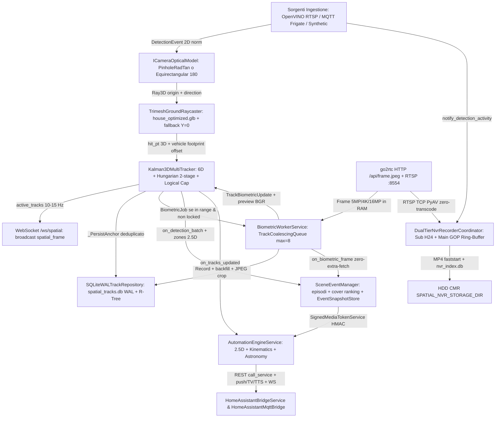

# Architettura Interna `spatial_server`: Spatial CV, Biometria, NVR, Episodi e Automazioni

> **Guida operativa del servizio:** per setup `.venv`, avvio dev/prod, catalogo completo dei 55 endpoint HTTP REST + `/ws/spatial`, ruoli RBAC e comandi di test, vedi [spatial_server/README.md](../../spatial_server/README.md).

Questo documento descrive in profondità l'architettura software, il flusso dati end-to-end, gli algoritmi matematici, le soglie operative e i contratti d'interfaccia di **tutti i 12 sottosistemi** che compongono `spatial_server`.

---

## 1. Orchestrazione Centrale e Configurazione (`main.py`, `config.py`)

### 1.1 Dependency Injection e `SpatialPipelineService`

L'applicazione FastAPI in [spatial_server/main.py](../../spatial_server/main.py) applica i principi **SOLID**: `build_pipeline_service()` istanzia e inietta tutte le strategie concrete dentro `SpatialPipelineService`, disaccoppiando l'orchestratore dalle implementazioni specifiche di ingestione, ottica, raycasting, tracking, biometria, persistenza e registrazione:

- **Modelli ottici (`optical_models`):** caricati dal SSoT [public/models/scene_manifest.json](../../public/models/scene_manifest.json) filtrando le camere con `is_real_security_camera`, `ha_camera_entity` o `Cam_Carraio`, e applicando eventuali override da `spatial_server/data/camera_calibrations.json` tramite `CameraCalibrationSolver`.
- **Raycaster 3D:** `TrimeshGroundRaycaster` su [public/models/house_optimized.glb](../../public/models/house_optimized.glb) + `scene_manifest.json`.
- **Repository persistente:** `SQLiteWALTrackRepository` su `spatial_server/data/spatial_tracks.db`.
- **Tracker multi-camera 3D:** `Kalman3DMultiTracker(initial_next_track_id=repository.get_max_track_id() + 1)` con hook `camera_visibility_fn = service.is_world_point_visible_in_camera`.
- **Coordinatore Biometrico (se `BIOMETRICS_ENABLED=true`):** `_build_biometric_coordinator(...)` costruisce `BiometricWorkerService` con `Go2RtcSnapshotProvider`, `TrackBiometricConsensusManager`, `BiometricEligibilityGate`, `OnnxInsightFaceRecognizer` e `OnnxAlprRecognizer`.
- **Identity Resolver sincrono fallback (`identity_resolver`):**
  1. Se `FACE_RECOGNITION_WEBHOOK_URL` è valorizzato → `ExternalWebhookIdentityResolver`.
  2. Altrimenti se `BIOMETRICS_ENABLED=false` ed esiste `models/face_gallery` → `OpenVINOInsightFaceResolver`.
  3. Altrimenti (caso standard con biometria asincrona attiva) → `NoOpIdentityResolver` (zero latenza sul thread di tracking, propaga eventuali `sub_label` da MQTT/Synthetic).
- **NVR Dual-Tier:** `FilesystemNvrArchiveRepository` + `DualTierNvrRecorderCoordinator`.
- **Episodi, Bridge HA/MQTT & Automazioni:** `SignedMediaTokenService`, `EventSnapshotStore`, `SceneEventManager`, `HomeAssistantBridgeService`, `HomeAssistantMqttBridge` e `AutomationEngineService`.

### 1.2 Ciclo di Vita (`lifespan`) e Loop di Manutenzione (`_db_flush_loop`)

All'avvio (`SpatialPipelineService.start()`):
1. Avvia nell'ordine: `biometric_coordinator`, `recorder_coordinator`, `ha_bridge`, `mqtt_bridge`, `automation_engine`.
2. Lancia il task asincrono `_db_flush_loop()` (ogni `0.5s`):
   - Esegue `flush_pending_to_db()` in executor per non bloccare l'event loop ASGI.
   - Ogni `>= 1.0s` invoca `scene_event_manager.tick(time.time())` per chiudere gli episodi scaduti per inerzia.
   - Ogni `> 3600s` esegue il pruning coordinato su: `track_history` (`SPATIAL_RETENTION_DAYS`, default `30`), `biometric_events` + `BiometricCropStore` (`BIOMETRICS_CROP_RETENTION_DAYS=14`, `BIOMETRICS_CROP_MAX_MB=250.0`), `scene_events` + `EventSnapshotStore` (`SPATIAL_EVENTS_RETENTION_DAYS=30`, `SPATIAL_EVENTS_SNAPSHOT_MAX_MB=400.0`).
3. Avvia la sorgente di ingestione configurata (`set_ingestion_mode(self.ingestion_mode)`).

### 1.3 Parsing Configurazione (`config.py`)

[SpatialServerConfig.from_env()](../../spatial_server/config.py) carica `.env` dalla root del repository e applica:
- **Interruttore `SH3D_DEV_MODE`**: se `true`, abilita override `VITE_HA_DEV_URL`, `SPATIAL_DEV_AUTH_REQUIRED`, `CV_DEV_INGESTION_MODE`, `BIOMETRICS_DEV_ENABLED` e aggiunge `DEFAULT_ALLOWED_ORIGINS` (`localhost`/`127.0.0.1` su porte `3000, 5173, 4173, 8080, 8765`) a `allowed_origins`.
- **Derivazione CORS e `public_app_url`**: `_derive_ha_public_origins` estrae l'origin di `VITE_HA_PUBLIC_URL` (e l'equivalente porta `:443` se host `*.ts.net`); se `SPATIAL_PUBLIC_URL` è vuoto, sceglie la prima origin HTTPS non locale in `allowed_origins` o ricade su `https://<ha_host>`.
- **Parser dedicati**: `_parse_camera_streams` (`CamId=url,...`), `_parse_biometrics_camera_rules` (`CamId:modality=max_range_m,...`), `_parse_nvr_trigger_classes`, `_parse_nvr_clock_offsets` (`CamId:sub|main=offset_ms,...`), `_parse_nvr_camera_streams` (`CamId=sub_url|main_url,...`), `_sanitize_db_filename`.

---

## 2. Flusso Dati End-to-End

### Sequenza Sincrona in `process_detection_batch()`

Ogni batch di `DetectionEvent` ricevuto da `SpatialPipelineService.process_detection_batch()` attraversa questi passi deterministici:
1. Se il batch è vuoto (heartbeat `1.0s` di OpenVINO): avanza la predizione/scadenza TTL del tracker sotto `_pipeline_lock`, pota consenso/ancore e trasmette `spatial_frame`.
2. Per ogni `DetectionEvent`:
   - Calcola il punto di contatto a terra `(u, v) = evt.bbox.get_ground_contact_uv()` (centro orizzontale, bordo inferiore `y_max`).
   - Proietta `ray = model.pixel_to_world_ray(u, v)` e interseca `hit_pt = raycaster.intersect_ground(ray)`. Se fallisce, incrementa `raycast_misses_count` e scarta.
   - Esegue `identity_resolver.resolve_identity(evt)` (O(1) con `NoOpIdentityResolver`).
   - Applica `_apply_vehicle_footprint_center_offset` per veicoli (`car`/`truck`/`motorbike`) spostando l'hit verso l'interno lungo la linea di vista orizzontale (`0.65m` auto/furgoni, `0.25m` moto, sfumato per `v_norm` in `[0.88, 0.965]`).
   - Costruisce `TrackObservation3D` con `range_m`, `is_panoramic`, `uv_contact`, `bbox_2d` e `ray_grazing_sin = |ray.direction[1]|`.
3. Aggiorna `tracker.update_with_assignments(observations, now_ts)` sotto `_pipeline_lock`.
4. Se `recorder_coordinator` è attivo (e `ingestion_mode != "synthetic"`), notifica ogni rilevazione per estendere o avviare la registrazione Main Stream.
5. Se `biometric_coordinator` è attivo, per ogni osservazione associata a un `track_id` non ancora `biometric_locked` (classi `person`, `car`, `truck`, `motorbike`), accoda un `BiometricJob` non bloccante.
6. Seleziona le tracce da persistere (`_select_tracks_to_persist`), trasmette `spatial_frame` su WebSocket, aggiorna `scene_event_manager.on_detection_batch(...)` (calcolando le zone poligonali 2.5D attive per ogni traccia) e infine invoca `automation_engine.on_tracks_updated(...)`.

---

## 3. Analisi Dettagliata dei 12 Sottosistemi

### 3.1 `domain` — Modelli Canonici e Coordinate 3D

File: [domain/models.py](../../spatial_server/domain/models.py)

Il sistema di riferimento mondiale è quello di **Three.js / glTF**: **`+X` Est, `+Y` Alto, `+Z` Sud** (in metri).

| Modello Pydantic | Campi / Comportamento chiave |
| :--- | :--- |
| `EntityClassLabel` | `Literal["person", "car", "truck", "bicycle", "dog", "motorbike"]`. |
| `BoundingBox2D` | Coordinate normalizzate in `[0, 1]^4` con origine in alto a sinistra (`x_min`, `y_min`, `x_max`, `y_max`). `get_ground_contact_uv()` restituisce `(0.5 * (x_min + x_max), y_max)`. |
| `DetectionEvent` | `camera_id`, `timestamp`, `class_label`, `confidence`, `bbox`, più campi opzionali `sub_label`, `face_confidence`, `plate`, `plate_confidence`, `track_hint_id`. |
| `Ray3D` | `origin: tuple[float, float, float]`, `direction: tuple[float, float, float]`. |
| `SpatialPoint3D` | Stato cinematico `(x, y, z, vx, vy, vz)`, `covariance_diag` (default `[0.25, 0.05, 0.25]`), `camera_sources`. |
| `TrackedEntity3D` | `track_id`, `class_label`, `confidence`, campi biometrici (`identity`, `identity_confidence`, `plate`, `plate_confidence`, `plate_whitelisted`, `plate_owner`, `biometric_locked`, `biometric_status` in `none\|pending\|locked\|unknown`, `best_crop_id`), `state: SpatialPoint3D`, `last_seen`. |
| `CalibrationOverridePayload` | `camera_id`, `offset_xyz`, `delta_euler_deg`, `fov_v_deg`, `fov_h_deg`, `distortion_coeffs`, `calibrated_matrix_world_gl` (validato esattamente a 16 float row-major), `ui_state`. |
| `PnPCorrespondence` / `SolvePnPRequest` | Coppie `(world_point, pixel_uv)` con minimo 4 corrispondenze (`min_length=4`). |

---

### 3.2 `ingestion` — Sorgenti di Rilevazione 2D

File: [interfaces.py](../../spatial_server/ingestion/interfaces.py), [synthetic_source.py](../../spatial_server/ingestion/synthetic_source.py), [openvino_rtsp_source.py](../../spatial_server/ingestion/openvino_rtsp_source.py), [mqtt_source.py](../../spatial_server/ingestion/mqtt_source.py).

Tutte le sorgenti implementano l'interfaccia asincrona `IDetectionSource` (`start(on_batch)`, `stop()`, `status_details()`). In modalità `"hybrid"` in `main.py`, vengono avviate contemporaneamente tutte le sorgenti `OpenVINORtspDetectionSource` e `MqttFrigateDetectionSource`.

#### `OpenVINORtspDetectionSource`
- **Target multi-camera (`_resolve_openvino_camera_targets`):** legge `OPENVINO_CAMERA_STREAMS` se impostato; altrimenti genera automaticamente uno stream RTSP per ogni camera del manifesto (usando `GO2RTC_RTSP_<SLUG>_SUB`, `sub_stream_id`, `stream_id` o `<slug>_sub` su `GO2RTC_RTSP_BASE_URL`). Il budget FPS totale `OPENVINO_FPS_LIMIT` (default `7.0`) viene ripartito tra le telecamere con pavimento `per_cam_fps = max(1.5, target_fps / n_cams)`.
- **Condivisione modello in RAM:** per risparmiare memoria sull'host `8 GB RAM`, solo la prima telecamera compila e fa warmup del modello OpenVINO/ORT; le telecamere successive riusano `shared_compiled_ov` protetto da un `threading.Lock` condiviso (`infer_lock`).
- **Catena di inferenza con fallback sicuro (`_init_detector`):**
  1. **OpenVINO Runtime IR (`.xml` + `.bin` FP16):** importa `openvino` con stub di `openvino_telemetry` (`_safe_import_openvino()`) per evitare errori di permesso su AppData Windows; imposta `INFERENCE_NUM_THREADS = cpu_threads` (default `2`); se caricato da `.onnx` senza `.xml`, salva la cache FP16 su disco (`ov.save_model(..., compress_to_fp16=True)`). Se `OPENVINO_DEVICE` (default `AUTO`) fallisce il warmup, ripiega automaticamente su `"CPU"`.
  2. **ONNX Runtime CPU (`onnxruntime_cpu`):** `InferenceSession` sul `.onnx` con `CPUExecutionProvider`.
  3. **Ultralytics YOLO (`ultralytics_openvino`):** se pacchetto `ultralytics` installato.
  4. **OpenCV HOG People Detector (`opencv_hog_fallback`):** fallback built-in solo per persone. *(La sottrazione di sfondo MOG2 è intenzionalmente disabilitata sui flussi reali perché rumore IR notturno e fogliame genererebbero decine di falsi positivi).*
- **Pre/Post-processing YOLOv8n (`_infer_openvino_yolo`):**
  - `_letterbox_bgr(..., target_size=640)` con bordo `(114, 114, 114)`, RGB normalizzato `[0, 1]` NCHW `(1, 3, 640, 640)`.
  - Mappatura classi COCO (`COCO_TO_DOMAIN`): `{0: "person", 1: "bicycle", 2: "car", 3: "motorbike", 7: "truck", 16: "dog"}`.
  - Filtro `conf >= conf_threshold` + `cv2.dnn.NMSBoxes(..., nms_threshold=0.45)`.
  - **Soppressione duplicati 2D (`deduplicate_2d_detections`):** raggruppa `car/truck/motorbike/motorcycle/bus` nella macro-classe `"vehicle"` ed elimina duplicati sullo stesso frame quando `IoU >= 0.38` (veicoli) / `0.45` (altri), oppure `containment >= 0.72` / `0.80`, oppure `close_bottom` (`du_bottom <= 0.35 * max_w`, `dv_bottom <= 0.22 * max_h` con intersezione > 0) — fondamentale per evitare doppie box sulle cuciture delle camere panoramiche 180°.
- **Cattura RTSP low-latency:** forza `OPENCV_FFMPEG_CAPTURE_OPTIONS = "rtsp_transport;tcp|fflags;nobuffer|flags;low_delay"`, `CAP_PROP_BUFFERSIZE=1`, esegue `grab()` continuo per svuotare i buffer e `retrieve()` solo alla cadenza di `frame_interval_s`. Mantiene in memoria `_latest_frame` (`get_latest_frame()`) per fallback rapido di biometria ed eventi. Emette un heartbeat vuoto `on_batch([])` ogni `1.0s` in assenza di rilevazioni per far avanzare i TTL del tracker.

#### `MqttFrigateDetectionSource`
- Client `aiomqtt` con riconnessione exponential backoff (`2.0s` → `30.0s`).
- Supporta sia il payload nativo **Frigate NVR** (`frigate/events`, ignorando `type == "end"`, normalizzando coordinate pixel tramite `frame_width`/`frame_height` se `> 1.5`, leggendo `sub_label` e `recognized_license_plate` + `recognized_license_plate_score`), sia uno schema JSON flat (`class_label`, `bbox`, `camera_id`, `timestamp`, `confidence`, `sub_label`, `plate`).
- Normalizza `"motorcycle"` → `"motorbike"` e risolve gli alias camera tramite `camera_alias_map` generato dinamicamente da `main.py` usando nomi manifest, slug e `ha_camera_entity`.

#### `SyntheticWalkSimulatorSource`
- Emette a `10.0 Hz` (`rate_hz=10.0`) una persona (`sub_label="Nicola"`, `face_confidence=0.91`) e ciclicamente ogni `30s` un'auto (`class_label="car"`) proiettando le coordinate 3D reali nel modello ottico di `Cam_Carraio` tramite `_project_or_uv`.

---

### 3.3 `optics` — Modelli Ottici e Calibrazione 6-DoF

File: [interfaces.py](../../spatial_server/optics/interfaces.py), [pinhole_model.py](../../spatial_server/optics/pinhole_model.py), [panoramic_model.py](../../spatial_server/optics/panoramic_model.py), [calibration_solver.py](../../spatial_server/optics/calibration_solver.py).

#### Conversione Basi OpenCV ↔ Three.js
I due sistemi differiscono per la direzione degli assi Y e Z locali alla camera:
- **OpenCV (`CV`):** `+X` destra, `+Y` giù, `+Z` avanti.
- **Three.js / glTF (`GL`):** `+X` destra, `+Y` su, `-Z` avanti.

La matrice di cambio base definita in `pinhole_model.py` è `S_GL_FROM_CV = np.diag([1.0, -1.0, -1.0, 1.0])`:
- `matrix_gl_to_cv(M_gl) = M_gl @ S_GL_FROM_CV`
- `matrix_cv_to_gl(M_cv) = M_cv @ S_GL_FROM_CV`

#### `PinholeRadTanOpticalModel` (RLC-540A / RLC-810A)
- Costruisce la matrice intrinseca $K$ su risoluzione nominale `1920x1080` dai FOV orizzontale e verticale:
  $$f_x = \frac{W / 2}{\tan(\text{fov}_h / 2)}, \quad f_y = \frac{H / 2}{\tan(\text{fov}_v / 2)}, \quad c_x = \frac{W}{2}, \quad c_y = \frac{H}{2}$$
- Applica distorsione radiale-tangenziale Brown-Conrady a 5 coefficienti `[k1, k2, p1, p2, k3]` (default `[-0.18, 0.04, 0.0, 0.0, 0.0]`):
  - `pixel_to_world_ray(u, v)`: converte in pixel `(u * W, v * H)`, chiama `cv2.undistortPoints` per ottenere `(x_cam, y_cam, 1.0)`, ruota tramite `T_world_cv[:3, :3]` e normalizza il vettore direzione; l'origine è `T_world_cv[:3, 3]`.
  - `world_point_to_pixel(p_w)`: trasforma nel frame CV con `inv(T_world_cv)`; scarta se `p_cv[2] <= 0.05` (dietro camera); proietta con `cv2.projectPoints`.

#### `EquirectangularPanoramicOpticalModel` (Reolink Duo 3 PoE 180°)
Istaziata automaticamente da `create_optical_model_from_manifest` quando `optical_model` contiene `"equirectangular"`/`"panoramic"` o `fov_h_deg >= 150.0` (es. `Cam_Ingresso` e `Cam_Stradina`, `180° × 55°`):
- `pixel_to_world_ray(u, v)`:
  $$\theta = \text{rad}((u - 0.5) \cdot \text{fov}_h), \quad \phi = \text{rad}((v - 0.5) \cdot \text{fov}_v)$$
  $$\vec{d}_{cv} = [\cos\phi \sin\theta,\; \sin\phi,\; \cos\phi \cos\theta]^T$$
  Ruota poi $\vec{d}_{cv}$ con `T_world_cv[:3, :3]`.
- `world_point_to_pixel(p_w)`: calcola $\theta = \operatorname{atan2}(x_{cv}, z_{cv})$ e $\phi = \arcsin(y_{cv} / \|\vec{p}_{cv}\|)$, scartando punti con $|\theta| > 0.55 \cdot \text{fov}_h$ o distanza `< 0.05m`.

#### `CameraCalibrationSolver`
- `solve_pnp_ransac(optical_model, correspondences)` (richiede modello pinhole e `>= 4` landmark 3D↔2D):
  1. Inizializza `rvec_init, tvec_init` dalla posa attuale `inv(T_world_cv)`.
  2. Esegue `cv2.solvePnPRansac(..., useExtrinsicGuess=True, iterationsCount=200, reprojectionError=12.0, flags=cv2.SOLVEPNP_ITERATIVE)`.
  3. Se non converge, riprova senza guess iniziale (`useExtrinsicGuess=False, iterationsCount=300, reprojectionError=16.0, flags=SOLVEPNP_SQPNP`).
  4. **Guardia geometrica anti-degenerazione:** rifiuta la soluzione (`RuntimeError`) se la posizione stimata della camera si sposta di `> 3.0m` rispetto al montaggio fisico corrente (`pos_jump_m > 3.0`).
- Persiste gli override su `spatial_server/data/camera_calibrations.json` con scrittura atomica (`tempfile.mkstemp` + `os.fsync` + `os.replace`) protetta da `threading.RLock`.

---

### 3.4 `geometry` — Raycasting 3D sui Collider Terreno

File: [geometry/interfaces.py](../../spatial_server/geometry/interfaces.py), [geometry/raycaster.py](../../spatial_server/geometry/raycaster.py).

`TrimeshGroundRaycaster` carica [public/models/house_optimized.glb](../../public/models/house_optimized.glb) e legge la lista `ground_colliders` da `scene_manifest.json` (20 nodi calpestabili/carrabili tra cui `Driveway_Gravel`, `Floor_*`, `Giardino_Area_*`, `Portico_Pavement_Unified`, `Site_Foundation_Earth`, `Terrazza_All_Aperto`, `Walkway_Pedestrian_Pavement`):
- Attraversa `scene.graph.nodes_geometry`, confronta i nomi nodo/geometria gestendo i suffissi delle primitive glTF (es. `Driveway_Gravel_0` via `startswith`), applica la matrice di trasformazione mondiale di scena a ciascuna mesh e le concatena in un'unica `trimesh.Trimesh` (`self.ground_mesh`).
- `intersect_ground_detailed(ray, fallback_plane_y=0.0)`:
  - Interseca `self.ground_mesh.ray.intersects_location(..., multiple_hits=True)` e seleziona l'impatto **più vicino** nel range valido `[min_distance_m=0.3, max_distance_m=60.0]`.
  - Se il GLB è assente o il raggio non colpisce nessuna mesh nel range valido, usa il **piano fallback orizzontale** `y = 0.0` (purché `|direction[1]| > 1e-5` e `0.3 <= t <= 60.0`).

---

### 3.5 `tracking` — Kalman 3D Multi-Camera e Fusione Anti-Cloning

File: [tracking/interfaces.py](../../spatial_server/tracking/interfaces.py), [tracking/kalman_tracker.py](../../spatial_server/tracking/kalman_tracker.py).

`Kalman3DMultiTracker` implementa un tracker 3D progettato per gestire asincronia tra telecamere, imperfezioni di calibrazione residua e campi visivi sovrapposti (Pinhole + 180° Panoramica).

#### Stato, Predizione e Clamping Fisico (`_KalmanTrack`)
- Vettore di stato 6D: $\mathbf{x} = [x, y, z, v_x, v_y, v_z]^T$, covarianza $P \in \mathbb{R}^{6 \times 6}$ (inizializzata a $\text{diag}(p_{0,xz}, 0.1, p_{0,xz}, 1.5, 0.5, 1.5)$).
- Modello cinematico lineare a velocità costante con passo `dt = clamp(now_ts - last_ts, 0.0, 2.0)`:
  - Smorzamento verticale `vy *= 0.7` e decadimento esponenziale in coasting (`dt > 0.25s` → `vx, vz *= exp(-0.45 * (dt - 0.25))`).
  - Clamping velocità massima orizzontale: `13.5 m/s` per veicoli (`car/truck/bus/motorcycle/motorbike`), `4.2 m/s` per persone/altri; `vy` clampato in `[-1.5, 1.5] m/s`.
  - Rumore di processo (`process_noise=0.45`): `q_pos = 0.45 * dt^2`, `q_vel = 0.675 * dt` (asse Y scalato `0.25×`).

#### Varianza Adattiva della Misura (`_compute_measurement_variance`)
La varianza $R_{xz}$ di ogni `TrackObservation3D` viene modulata in base a:
1. **Distanza al quadrato e confidenza:** `base_var = 0.18 + 0.0012 * range_m^2`, poi `r_var = base_var / max(confidence, 0.25)`.
2. **Camera panoramica 180°:** fattore `1.45 * (1.0 + 1.25 * edge_u^2)` (con `edge_u = min(1.0, |u - 0.5| / 0.5)`), più penalità seam centrale `1.15` se `|u - 0.5| < 0.035`.
3. **Troncamento bordo inferiore:** se `v >= 0.965` (piedi/ruote tagliati), `r_var *= 3.2`.
4. **Angolo radente (`ray_grazing_sin`):** se `sin_g < 0.26`, `r_var *= min(3.2, (0.26 / sin_g)^1.2)`.
- Pavimento minimo: `max(0.05, r_var)`. Matrice $R = \text{diag}(r_{\text{eff}}, 0.35 r_{\text{eff}}, r_{\text{eff}})$.

#### Fusione Multi-Camera Anti-Ping-Pong e Disaccoppiamento Velocità
Quando più telecamere osservano lo stesso target con un piccolo offset di calibrazione:
- `_compute_multicam_consensus_measurement` calcola la posizione di consenso pesata per precisione (`time_decay / cam_var` con `time_decay = exp(-0.7 * age)` su finestra `active_window_s = 1.8s`), proiettando in avanti le misure delle altre camere con `0.5 * min(age, 1.0) * v`.
- **Disaccoppiamento velocità:** quando `active_cams_count >= 2` oppure avviene un cambio camera (`is_cross_cam_switch`), il filtro aggiorna la posizione verso il consenso ma **impedisce allo scarto spaziale inter-camera di generare picchi fittizi di velocità**, usando la velocità finita intra-camera (`intra_cam_vel`) pesata per `alpha_v` in `[0.18, 0.65]` (oppure attenuando `0.92 * saved_vel` alla prima osservazione della camera secondaria).

#### Pipeline di Associazione per Batch (4 Fasi)
1. **Fase 0 — Deduplicazione Intra-Camera (`_deduplicate_camera_batch`):** sopprime duplicati dello stesso target in un singolo frame camera se appartenenti alla stessa macro-classe (`vehicle` vs altro) e compatibili biometricamente, quando `dist_3d <= 2.25m` (veicoli) / `0.58m` (persone) oppure `IoU/containment` 2D superano soglia.
2. **Fase 1 — Matching Ungherese (`linear_sum_assignment`):**
   - Usa la distanza minima tra `dist(tr.x[:3], obs)` e `dist(expected_position_for_camera(cam_id), obs)` (compensa offset locali di calibrazione fino a `3.5s`).
   - **Gate adattivi:**
     - Persona: intra-camera `2.2m` (cap `3.2m`), cross-camera `3.8m` (cap `5.0m`), bonus range `+0.06 * max(0, range_m - 5.0)`.
     - Veicolo: intra-camera `4.2m` (cap `5.5m`), cross-camera `6.5m` (cap `8.2m`), bonus range `+0.08 * max(0, range_m - 6.0)`.
     - Bonus panoramica cross-camera: `base_gate *= 1.12`.
   - Aggiustamenti di costo: `-0.6` stessa identità volto, `-0.9` stessa targa, `-0.15` affinità stessa telecamera. Compatibilità biometrica rigida (`_obs_biometrically_compatible`): due identità o targhe diverse note non vengono mai fuse.
3. **Fase 2 — Fallback di Cardinalità Logica:** per osservazioni rimaste non associate in una zona condivisa (`uncalibrated_zone_person_m=5.5m`, `uncalibrated_zone_vehicle_m=9.0m`), se creare una nuova traccia supererebbe `logical_max = max(max_cam_count, bio_floor)` (`_compute_zone_logical_max`), forza il matching ungherese con la traccia non ancora assegnata nella zona.
4. **Fase 3 & Post-Merge (`_merge_and_enforce_cardinality`):** crea nuove tracce per le osservazioni residue (con `track_ttl_s=4.5s`), quindi esegue:
   - **Pass A/B:** fonde coppie non co-osservate nello stesso batch camera (`_co_observed_in_same_camera_batch`) se condividono stessa identità/targa entro `12.0m` o se distano `<= merge_radius` (`2.6m` persone, `4.8m` veicoli).
   - **Pass C:** calcola le componenti connesse entro `uncalibrated_zone_*_m` e fonde iterativamente le coppie più vicine finché la cardinalità del cluster non rispetta `logical_max`. La priorità di mantenimento ID (`_track_priority_key`) privilegia: `biometric_locked`, presenza di biometria, numero di camere, `hits`, e `track_id` più vecchio (minore).

---

### 3.6 `biometrics` — Face Recognition & ALPR Asincroni Dual-Stream

File: [models.py](../../spatial_server/biometrics/models.py), [interfaces.py](../../spatial_server/biometrics/interfaces.py), [worker.py](../../spatial_server/biometrics/worker.py), [snapshot_provider.py](../../spatial_server/biometrics/snapshot_provider.py), [face_pipeline.py](../../spatial_server/biometrics/face_pipeline.py), [alpr_pipeline.py](../../spatial_server/biometrics/alpr_pipeline.py), [face_gallery.py](../../spatial_server/biometrics/face_gallery.py), [crop_store.py](../../spatial_server/biometrics/crop_store.py), [consensus.py](../../spatial_server/biometrics/consensus.py), [plate_postprocessor.py](../../spatial_server/biometrics/plate_postprocessor.py), [resolvers.py](../../spatial_server/biometrics/resolvers.py), [onnx_runtime_utils.py](../../spatial_server/biometrics/onnx_runtime_utils.py).

Per non rallentare il tracking 3D su CPU (i5-6400 4 core) e non consumare banda decodificando 4 stream 4K/16MP continui, la biometria adotta un'architettura **dual-stream on-demand**: il tracking viaggia sui sub-stream a bassa risoluzione, e solo quando una traccia entra in range utile viene scaricato uno snapshot JPEG ad alta risoluzione via HTTP da go2rtc.

#### Gate di Idoneità e Coda Coalescente (`worker.py`)
- **`BiometricEligibilityGate`:**
  - Modalità `"face"` (`class_label == "person"`): range default `8.0m`, bbox minima `0.015 × 0.035`.
  - Modalità `"alpr"` (`class_label in {"car", "truck", "motorbike"}`): range default `13.0m`, bbox minima `0.035 × 0.025`.
  - Supporta override per telecamera via `BIOMETRICS_CAMERA_RULES` (`CameraId:face=...,CameraId:alpr=...`).
  - Sulle camere panoramiche 180°, scarta i soggetti sui bordi estremi (`u_center < 0.15` o `u_center > 0.85`) e riduce il peso di voto (`camera_weight <= 0.75`).
  - Verifica che la traccia non sia già `locked` e rispetti il cooldown (`0.6s` per i primi `6` tentativi rapidi, poi `unknown_backoff_s = 4.0s`).
- **`TrackCoalescingQueue`:** coda bounded (`maxsize=8`) indicizzata per `(track_id, modality)`. Se arriva un'osservazione più recente per la stessa traccia già in coda, la sostituisce in-place (`coalesced_count`); se satura su tracce distinte, scarta l'elemento più vecchio (`dropped_count`).
- **`BiometricWorkerService`:** esegue su singolo worker thread (`max_workers=1`, `biometric-onnx`) per evitare contesa sui thread OpenMP/ORT.

#### Fetch RAM-Only e Circuit-Breaker (`snapshot_provider.py`)
- `Go2RtcSnapshotProvider` interroga `GET http://127.0.0.1:1984/api/frame.jpeg?src=<stream>` (ordine candidati da `scene_manifest.json`: `<slug>_snap` → `<slug>_main`, timeout `2.5s`).
- **Decodifica memory-safe per camere 16MP (`decode_and_crop_jpeg`):** ispeziona il marker JPEG SOF in RAM senza allocare pixel (`parse_jpeg_dimensions`); se `is_panoramic_180=True` e `width > 3840`, decodifica a metà risoluzione con `cv2.IMREAD_REDUCED_COLOR_2` (evitando allocazioni da ~48 MB).
- Ritaglia la ROI espansa (`(0.20, 0.15, 0.20, 0.10)` con `prefer_upper_fraction=0.60` per volti; `(0.18, 0.18, 0.18, 0.18)` per targhe), genera una `preview_frame_bgr` ridimensionata max `1280px` (riutilizzata a costo zero da `SceneEventManager`) e libera subito `full_img`.
- **Circuit-breaker per camera:** dopo `3` fallimenti consecutivi apre il circuito per `15.0s` e ripiega temporaneamente sul frame substream in RAM (`_substream_fallback_getter`, valido se età `<= 2.5s`).

#### Pipeline Volti (`face_pipeline.py` + `face_gallery.py`)
Eseguita interamente su ONNX Runtime puro (nessuna dipendenza da PyTorch, `dlib` o pacchetto `insightface`):
1. **Rilevazione SCRFD (`det_500m.onnx`):** inferenza su canvas letterbox `640×640` con stride `(8, 16, 32)`, `det_conf_threshold=0.50`, NMS IoU `0.40`. Se non rileva volti su crop stretti (`min(h, w) >= 40`), riprova con padding costante grigio del `35%` (`_detect_with_border_fallback`, soglia `0.45`).
2. **Quality Gate (`FaceQualityMetrics`):** rifiuta il volto se `face_width_px < 48.0`, varianza del Laplaciano `blur_laplacian < 35.0`, o asimmetria occhi-naso `yaw_ratio > 0.55`.
3. **Allineamento ArcFace & Embedding (`w600k_mbf.onnx` / `w600k_r50.onnx`):** trasforma i 5 landmark su `ARCFACE_DST` (`112×112`) con `cv2.estimateAffinePartial2D` (LMEDS, fallback RANSAC), normalizza `(px - 127.5) / 127.5`, estrae vettore **512-D L2-normalizzato**.
4. **Matching Galleria (`FaceGalleryIndex`):** confronta il coseno sia con il **centroide** sia con fino a `8` **embedding rappresentativi diversi** per persona (`rep_embeddings` selezionati massimizzando diversità e qualità). Accetta l'identità solo se `best_score >= 0.45` (`match_threshold`) **e** (se presenti >= 2 persone) `best_score - max(0, second_best) >= 0.08` (`margin_threshold`).

#### Pipeline Targhe ALPR (`alpr_pipeline.py` + `plate_postprocessor.py`)
1. **Rilevazione Targa:** `open-image-models` con `yolo-v9-t-384-license-plate-end2end.onnx` (`384×384`, `det_conf_threshold=0.30`), seleziona il box con massimo `conf * width`.
2. **Quality Gate (`PlateQualityMetrics`):** rifiuta se `plate_width_px < 55.0`, `blur_laplacian < 20.0`, o abbagliamento IR `glare_ratio > 0.65` (frazione di pixel con luminanza `>= 245`).
3. **Pre-processing OCR:** applica CLAHE (`clipLimit=2.0`, `4×4`) sul canale L in spazio LAB **solo** su targhe scure senza abbagliamento (`mean_luma < 80.0` e `glare_ratio < 0.15`), poi converte in RGB (per `cct-xs-v2-global-model`, `64×128`) o grayscale (per `european-plates-mobile-vit-v2-model`, `70×140`).
4. **OCR & Post-Processing Deterministico (`normalize_and_validate_plate`):**
   - Alfabeto italiano valido (`IT_VALID_LETTERS = "ABCDEFGHJKLMNPRSTVWXYZ"`, esclude `I, O, Q, U`).
   - Formati validati: `IT_STD` (`LLNNNLL`), `IT_MOTO` (`LLNNNNN`), `EU_GENERIC` (`4..9` caratteri alfanumerici con almeno una lettera e una cifra).
   - Ripara fino a `2` ambiguità posizionali OCR (`0↔D`, `1↔L`, `8↔B`, `O→D/0`, ecc.) e gestisce artefatti della fascia blu EU (`I` iniziale su 8/9 caratteri o suffissi provincia/anno su 9 caratteri), applicando `0.04` di penalità confidenza per ogni riparazione.
5. **Whitelist Fuzzy (`PlateWhitelistMatcher`):** post-consenso applica distanza di Levenshtein (`max_distance=1` solo se lunghezza targa `>= 6`), rigettando eventuali pareggi a distanza minima.

#### Consenso Multi-Frame e Archiviazione Crop (`consensus.py` + `crop_store.py`)
- `TrackBiometricConsensusManager` accumula voti pesati (`conf * quality_score * camera_weight`).
- Quando l'etichetta vincente raggiunge `K=2` conferme concordi (`face_consensus_k`, `alpr_consensus_k`), marca `biometric_locked=True` e `biometric_status="locked"`.
- Se dopo `6` tentativi rapidi non ci sono voti validi, emette `biometric_status="unknown"` (entrando in backoff di `4.0s`) così la UI/HITL può mostrare il miglior crop acquisito.
- `BiometricCropStore` conserva **solo il singolo miglior thumbnail JPEG** per traccia (`max_side_px=320`, `jpeg_quality=82`) sotto `crops/YYYY-MM-DD/<crop_id>.jpg`, eliminando atomicamente il precedente crop se superato in qualità.

---

### 3.7 `events` — Episodi Scena (`SceneEvent`), Snapshot Annotati e Media Firmati

File: [models.py](../../spatial_server/events/models.py), [manager.py](../../spatial_server/events/manager.py), [annotator.py](../../spatial_server/events/annotator.py), [narrator.py](../../spatial_server/events/narrator.py), [signing.py](../../spatial_server/events/signing.py).

- **`SceneEventManager`:** aggrega tutte le tracce 3D e le camere attive in un episodio continuo (`evt_<ms>_<hex4>`) finché non trascorrono `SPATIAL_EVENTS_INERTIA_S` (`18.0s`) dall'ultima attività (`tick()` chiude l'episodio). Calcola `replay_start_at = started_at - 3.0s`.
- **Livello di importanza (`_compute_importance`):**
  - `"alert"`: se `sh3d.allarme` è armato (non in `off/false/0/spento/disarmed/disarmato/none`) ed è presente almeno una persona sconosciuta (o se escalato da una regola `ui_alert` `critical`).
  - `"notable"`: persona sconosciuta o veicolo non in whitelist (o soggetto senza identità).
  - `"routine"`: tutti i soggetti identificati/autorizzati.
- **Scelta e cattura cover (`compute_camera_frame_score`):** valuta ogni camera combinando peso ottico (`1.35` pinhole vs `0.85` panoramica 180°), area del soggetto (`area * 8.5` cap `1.5`), centratura orizzontale, penalità sui bordi panoramici (`0.55`) e clipping inferiore (`0.7`), bonus multi-soggetto (`+0.35 * (n-1)`) e bonus biometrico (`quality * 2.5 + 1.0 se locked`). Aggiorna la cover asincronamente (rate-limit `0.4s` per la prima cover, `1.8s` per miglioramenti di almeno `+0.25`) o a costo zero tramite `on_biometric_frame()` riutilizzando `preview_frame_bgr`.
- **`EventSnapshotStore` & `annotate_scene_frame_bgr`:** salva coppie `<event_id>_raw.jpg` e `<event_id>_ann.jpg` (max `1280px` larghezza, JPEG quality `84`). Disegna bbox esterna + sub-bbox biometrica con palette Material 3 (`known`/`plate_wl` emerald `#10b981`, `unknown` rose `#f43f5e`, `plate_guest` amber `#f59e0b`, `object` sky `#38bdf8`) e badge etichetta/timestamp. Supporta `reannotate_event()` da `_raw.jpg` dopo review HITL senza richiedere un nuovo frame alla camera.
- **`narrator.py`:** sintetizza titoli e frasi naturali in italiano (`build_scene_title_it`, `build_scene_sentence_it`, `format_location_it`), combinando persone note, sconosciuti, targhe/proprietari, animali/bici e nomi zona/camera.
- **`SignedMediaTokenService`:** genera e verifica in tempo costante (`hmac.compare_digest`) token URL `exp` + `sig` (`base64url(HMAC-SHA256(secret, "{event_id}:{variant}:{exp}"))`) con TTL default `86400s`.

---

### 3.8 `automations` — Motore Spaziale 2.5D, Pre-Trigger, Cinematica, Astronomia e Azioni

File: [models.py](../../spatial_server/automations/models.py), [geometry.py](../../spatial_server/automations/geometry.py), [kinematics.py](../../spatial_server/automations/kinematics.py), [astronomy.py](../../spatial_server/automations/astronomy.py), [evaluators.py](../../spatial_server/automations/evaluators.py), [correlator.py](../../spatial_server/automations/correlator.py), [actions.py](../../spatial_server/automations/actions.py), [engine.py](../../spatial_server/automations/engine.py).

- **Geometria 2.5D (`SpatialGeometryEngine`):**
  - **Aree poligonali (`geometry_type="polygon"`):** test point-in-polygon ray-casting sul piano XZ + intervallo quota `[y_min, y_max]` + **isteresi spaziale** (`hysteresis_m`, default `0.12m`) quando una traccia è già dentro, evitando rimbalzi sul confine.
  - **Perimetri / Tripwire orientati (`geometry_type="perimeter"` o bordo poligono):** intersezione esatta tra il segmento di spostamento `prev_xyz → curr_xyz` e ciascun segmento `A → B` della polilinea; calcola la normale unitaria `(-dz, +dx) / ||AB||` (invertibile con `normal_flipped`) per distinguere il verso di attraversamento `a_to_b` vs `b_to_a`.
- **Buffer Cinematico (`TrackKinematicHistoryBuffer`):** mantiene fino a `1200` campioni (`120s`) per traccia, calcola permanenze continue nelle zone (`ZonePresenceState`), transizioni `Area A → Area B` (`ZoneTransitionEvent`), visite recenti (`was_track_in_zone_recently`), e metriche su finestra mobile (`WindowKinematicMetrics`: `mean_speed_mps`, `peak_speed_mps` su sotto-finestra scorrevole anti-jitter, `min_speed_mps`, `current_speed_mps`, azimut medio in `[0°, 360°)` con `0°=+X Est, 90°=+Z Sud`, e `directional_consistency` in `[0, 1]`).
- **Orologio Astronomico (`AstronomicalClock`):** calcolo pure-Python NOAA (zenit `90.833°` per rifrazione atmosferica) su `HOME_LATITUDE` / `HOME_LONGITUDE` (default `45.55° N, 11.55° E`).
- **Pre-Trigger Temporali e Sequenze (`RuleSequenceCoordinator` & `CorrelationPolicy`):**
  - Ogni regola supporta una lista ordinata di `PreTriggerStageSpec` (`pre_triggers`) con finestra d'attesa `[min_delay_s, max_wait_s]`, modalità interna `any` (OR) / `all` (AND entro `stage_window_s`), guardia opzionale `stage.condition`, `refresh_on_rearm`, `consume_on_fire` e scope di correlazione (`same_subject`, `same_track`, `same_scene_event`, `any`).
  - `same_subject` garantisce l'isolamento multi-veicolo (due tracce attive contemporaneamente non vengono mai correlate tra loro) consentendo al contempo l'handoff in caso di occlusione dentro lo stesso `SceneEvent`.
  - I trigger principali supportano `trigger_logic="or"` oppure `"and_within"` (tutti i trigger principali abilitati entro `trigger_window_s` in qualsiasi ordine).
  - Stato live armato esposto via `GET /api/v1/automations/armed` + WS `automation_pretrigger_updated`, e ring-buffer diagnostico in memoria via `GET /api/v1/automations/rules/{rule_id}/diagnostics`.
- **Trigger (`TriggerRegistry`, Strategy Pattern — 9 evaluator):**
  1. `zone_presence` (`enter`, `present`, `exit`, `dwell` con `min_dwell_s`)
  2. `perimeter_crossing` (`a_to_b`, `b_to_a`, `both`)
  3. `zone_transition` (`from_zone_id → to_zone_id` con `max_transit_s` e bounds velocità)
  4. `kinematic_vector` (`target_azimuth_deg ± azimuth_tolerance_deg`, `min/max_speed_mps`, `min_consistency`, `min_duration_s`)
  5. `time_schedule` (`fixed_time`, `sunrise`, `sunset` con `offset_minutes`, `interval`, filtro `days_of_week`)
  6. `entity_state_change` (su entità virtuali `sh3d.*` o entità HA specchiate, con `from_state`, `to_state` e `for_duration_s` hold timer)
  7. `biometric_detection` (scatta su `on_biometric_update` filtrando per `modality`, `camera_id`, `zone_id` opzionale, `require_locked` e `SubjectFilterSpec`)
  8. `proximity_3d` (distanza euclidea XZ `<= radius_m` da `(target_x, target_z)` per `min_dwell_s`)
  9. `scene_event` (ciclo di vita `SceneEventManager`: `started`, `importance_escalated`, `closed`)
- **Condizioni (`ConditionRegistry` + `ConditionEvaluator`) & Filtri (`SubjectFilterEvaluator`):** AST booleano ricorsivo (`and`, `or`, `not`, `xor`) con 7 strategie foglia registrate: `entity_state`, `time_window` (incluso overnight e `sun_state`), `zone_occupancy`, `track_kinematics` (`evaluation_mode` tra `mean`, `peak_in_window`, `min_in_window`, `current` su `window_s` fino a `120s`), `subject_filter`, `scene_event` e `recent_zone_visit`.
- **Late Biometric Binding (`DeferredBiometricManager`):** ancora la finestra di grazia `biometric_grace_s` (fino a `60s`) al momento del trigger (non a `track_first_seen`), con deduplicazione per `(rule_id, stage_key, trigger_id, track_id)`, deep-copy dello stato shadow e distinzione tra filtri positivi (attesa fino a match o `biometric_locked`/`expires_at`) e filtri negativi.
- **Esecuzione Azioni (`ActionRegistry` + `AutomationEngineService`):**
  - Modalità di concorrenza per regola: `single`, `restart`, `parallel`, `queued` + `cooldown_s` (esecuzione non bloccante in background quando l'albero azioni contiene `delay`).
  - Azioni registrate in `ActionRegistry`: `set_virtual_entity`, `call_ha_service`, `send_notification`, `ui_alert`, `delay` (cap `3600s`), `if_then_else` ricorsivo, `webhook` HTTP.
  - **`send_notification` bundle:** genera testo naturale italiano (`auto_scene`) o template `{{...}}` (`trigger.*`, `track.*`, `event.*`, `scene.*`, o qualsiasi `entity_id`), allega URL firmato HMAC, invia push iOS/Android (`tag` per deduplica, `priority=silent|normal|critical` con override DND su iOS/Android), toast WebOS TV (opzionalmente `tv_only_when_on`), TTS italiano + visualizzazione temporizzata (`play_media` dopo `2.5s`, poi `turn_off` dopo `display_duration_s`) su Nest Hub, pubblicazione JPEG su MQTT e **aggiornamento silenzioso** (`alert_once=True`) della notifica mobile se la biometria si risolve entro `25s`.

---

### 3.9 `recordings` — NVR Dual-Tier Zero-Transcode con Pre-Buffer RAM

File: [interfaces.py](../../spatial_server/recordings/interfaces.py), [media_backend.py](../../spatial_server/recordings/media_backend.py), [ring_buffer.py](../../spatial_server/recordings/ring_buffer.py), [sqlite_index.py](../../spatial_server/recordings/sqlite_index.py), [filesystem_nvr.py](../../spatial_server/recordings/filesystem_nvr.py), [retention.py](../../spatial_server/recordings/retention.py), [recorder_service.py](../../spatial_server/recordings/recorder_service.py).

- **Zero-Transcode PyAV (`media_backend.py`):**
  - `PyAvRtspPacketSource`: demux RTSP TCP (`stimeout`, `fflags=nobuffer`, `flags=low_delay`) dei pacchetti video (`h264`/`hevc`) e audio (`aac`/`mp3`/`mp2`/`opus`/`ac3`) senza decodifica frame, con consumo CPU minimo.
  - `PyAvMp4SegmentWriter`: muxer MP4 atomico (`.<stem>.tmp.mp4` → `replace`) con `movflags=+faststart` e rebase monotono di PTS/DTS relativo al primo pacchetto del segmento.
- **Tier 1 — Sub Stream Continuo H24 (`SubStreamContinuousWorker`):** registra ininterrottamente un segmento ogni `SPATIAL_NVR_SUB_SEGMENT_SEC` (`60.0s`) effettuando il taglio **esattamente al primo keyframe IDR successivo** alla soglia, garantendo continuità zero-gap.
- **Tier 2 — Main Stream su Evento con Pre-Buffer RAM (`MainStreamEventWorker` + `CompressedGopRingBuffer` + `MainEventStateMachine`):**
  - Mantiene costantemente in RAM un ring-buffer di `GopChunk` compressi allineati ai keyframe IDR (`max_duration = nvr_main_pre_roll_sec + 4.0`, budget memoria `SPATIAL_NVR_RAM_BUFFER_MAX_MB_PER_CAM = 48.0 MB` per camera).
  - La macchina a stati (`idle` → `buffering` → `recording`) si attiva su rilevazioni appartenenti a `SPATIAL_NVR_TRIGGER_CLASSES` (`person,car,truck,motorbike`) con `conf >= 0.55` (o trigger manuale API).
  - Alla transizione in `recording`, scarica su MP4 i GOP in RAM a partire dall'ultimo keyframe `<= trigger_started - 10.0s` (pre-roll), poi continua in tempo reale finché non scade `nvr_main_inertia_sec` (`15.0s`) su keyframe (o rollover automatico a `300.0s`).
  - Applica eventuali offset temporali per camera/tier (`SPATIAL_NVR_CAMERA_CLOCK_OFFSETS`).
- **Indice & Risoluzione Playback (`SQLiteNvrIndexStore` + `FilesystemNvrArchiveRepository`):**
  - `resolve_at()` seleziona prioritariamente il tier `main` se disponibile e riproducibile dal client (`allow_hevc`), altrimenti effettua fallback automatico su `sub` H.264 (`fallback_reason="hevc_unsupported_fallback_sub"`).
  - Calcola `switch_at_unix`, `effective_end_unix`, `next_segment` e `next_seek_offset_sec` (lookahead `120s`) per consentire al frontend il passaggio zero-gap `Sub → Main → Sub`.
- **Retention HDD (`DiskRetentionManager`):** eseguita ogni `300.0s`:
  1. Scadenza per età differenziata (`sub = 30 giorni`, `main = 60 giorni`).
  2. Guardia spazio libero (`min_free_gb = 50.0 GB`) e quota opzionale (`max_storage_gb`): elimina **tutti** i segmenti `sub` più vecchi prima di toccare i segmenti `main` ad alta risoluzione.

---

### 3.10 `integrations` — Bridge Home Assistant H24 e MQTT Discovery

File: [integrations/ha_bridge.py](../../spatial_server/integrations/ha_bridge.py), [integrations/mqtt_bridge.py](../../spatial_server/integrations/mqtt_bridge.py).

- **`HomeAssistantBridgeService`:**
  - Attivo 24/7 se `HA_BRIDGE_ENABLED=true`, `HA_TOKEN` è configurato ed esiste almeno un URL HA (`ha_local_url`, `ha_tailscale_url`, `ha_public_url`).
  - Mantiene una connessione WebSocket autenticata con reconnessione backoff (`2.0s → 30.0s`), esegue `get_states` + `get_services` per auto-discovering (`notify.*` classificati in `mobile_app`/`tv`/`other`, `media_player.*`, `tts.*`, e `switch/light/lock/cover/script/button.*`), si sottoscrive a `state_changed` (aggiornando in tempo reale `AutomationEngineService`) e a `mobile_app_notification_action` (gestendo i bottoni interattivi `SH3D_ALARM_SPENTO`/`OFF`, `SH3D_ALARM_SILENZIOSO`, `SH3D_ALARM_ACCESO`/`ON`, `SH3D_CALL_SERVICE:<domain>.<service>:<entity_id>`).
  - Esegue `call_service` via `httpx.AsyncClient` persistente provando per primo `_active_base_url`.
- **`HomeAssistantMqttBridge`:**
  - Opzionale (`HA_MQTT_BRIDGE_ENABLED=true` + `MQTT_BROKER_HOST`). Pubblica payload JSON Home Assistant MQTT Discovery per:
    - `camera.sh3d_ultimo_evento` (`sh3d/events/latest_annotated.jpg`)
    - `select.sh3d_allarme` (`sh3d/entity/allarme/state` ↔ `sh3d/entity/allarme/set`, opzioni default `["Spento", "Silenzioso", "Acceso"]`).

---

### 3.11 `persistence` — Repository SQLite WAL + R-Tree

File: [persistence/interfaces.py](../../spatial_server/persistence/interfaces.py), [persistence/repository.py](../../spatial_server/persistence/repository.py).

`SQLiteWALTrackRepository` implementa `ITrackRepository` su `spatial_server/data/spatial_tracks.db` con `threading.Lock`, `journal_mode=WAL`, `synchronous=NORMAL`, `temp_store=MEMORY`, `cache_size=-4000`:
- **Schema & Indici:** gestisce le 10 tabelle (`track_history`, `identities`, `biometric_events`, `face_embeddings`, `plate_whitelist`, `spatial_zones`, `virtual_entities`, `automation_rules`, `automation_logs`, `scene_events`) più la virtual table R-Tree `track_spatial_idx` (con migrazioni `ALTER TABLE` idempotenti all'avvio per compatibilità backward con DB esistenti).
- **Deduplicazione in scrittura (`_PersistAnchor` in `main.py`):** evita di saturare il DB quando un soggetto è fermo, scrivendo un record per la traccia solo se lo spostamento è `>= 0.15m`, se sono trascorsi `>= 10.0s` (heartbeat), oppure se cambia `identity`, `plate`, `biometric_locked` o `class_label`.
- **Backfill & Coerenza Storica (`backfill_track_biometrics`):** quando una persona o targa raggiunge il lock (automatico o via HITL Admin), aggiorna retroattivamente tutte le righe già salvate di quel `track_id` negli ultimi `600.0s`.
- **Deduplicazione Eventi Biometrici (`record_biometric_event`):** aggrega aggiornamenti sullo stesso `(track_id, modality)` entro `3600s` in un'unica riga di visita, impedendo a un successivo evento `unknown` di sovrascrivere una riga già `biometric_locked=1`.
- **Manutenzione:** ogni operazione di pruning (`prune_older_than`, `prune_biometric_events_older_than`, `prune_scene_events_older_than`) esegue `PRAGMA wal_checkpoint(TRUNCATE);` per restituire spazio al filesystem.

---

### 3.12 `security` — Autenticazione HA, Cookie HMAC e RBAC

File: [security/ha_auth.py](../../spatial_server/security/ha_auth.py).

- **`HomeAssistantAuthVerifier`:** verifica i token OAuth2 di Home Assistant tramite `auth/current_user` su WebSocket (primario, ricava `user_id`, `name`, `is_admin`, `is_owner`) o fallback **fail-closed** su REST `GET /api/` (forza `is_admin=False, is_owner=False`). Cache in memoria indicizzata su `SHA-256(token)` con TTL `120.0s` (max `1024` voci).
- **Cookie `sh3d_session`:** token stateless `base64url(json_v1).base64url(hmac_sha256)` valido `43200.0s` (12h), flag `HttpOnly`, `SameSite=Strict`, `Secure` attivo quando `request.url.scheme == "https"` o `X-Forwarded-Proto == "https"`.
- **Dipendenze FastAPI & Fallback Dev:**
  - `require_authenticated_user`: accetta cookie `sh3d_session` (con fallback a `Authorization: Bearer` se il cookie è scaduto/invalido) oppure emette `synthetic_local_admin_principal()` se `SPATIAL_AUTH_REQUIRED=false`.
  - `require_admin_user`: verifica `principal.is_privileged` (`is_admin or is_owner`), altrimenti `403 Forbidden`.
  - `authenticate_websocket`: applica la stessa risoluzione credenziali sull'upgrade di `/ws/spatial`, chiudendo con codice `4401` in caso di errore.
