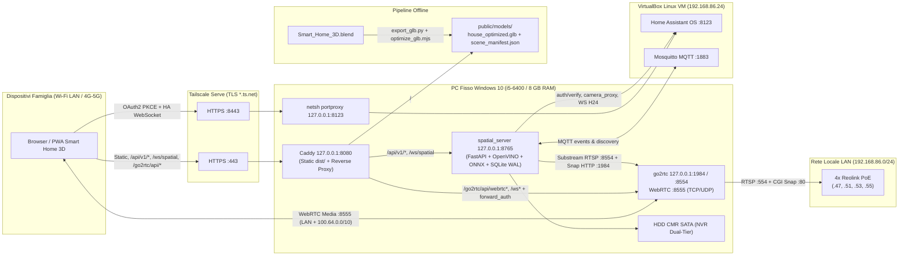
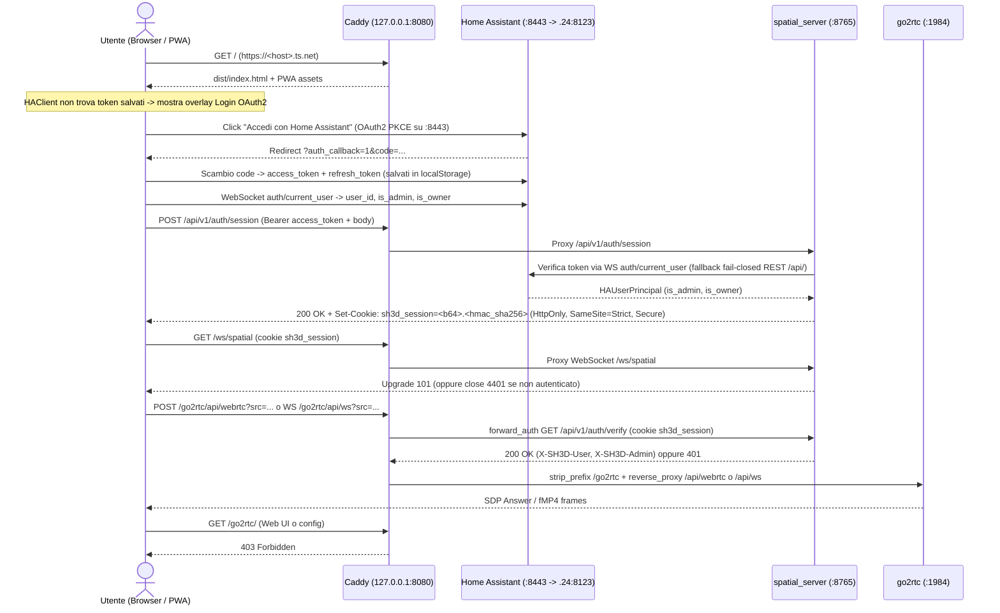

# Panoramica Architetturale End-to-End (`Smart_Home_3D`)

Questo documento descrive l'architettura completa di **Smart_Home_3D Digital Twin & Spatial CV Engine**, coprendo la topologia di rete, la mappa delle porte, il flusso di sicurezza end-to-end (`OAuth2 PKCE` + `sh3d_session` + `forward_auth`), le modalità operative (`Produzione`, `Sviluppo`, `LAN`, `Tailscale`) e il budget hardware del nodo di produzione.

---

## 1. Servizi e Componenti Principali

Il sistema adotta un'architettura **100% nativa Windows 10** sul nodo di produzione (senza Docker Desktop né WSL2), affiancata da una VM VirtualBox dedicata a Home Assistant e al broker MQTT:

| Componente | Tecnologia / Binario | Ruolo Architetturale | Bind / Esposizione |
|---|---|---|---|
| **Browser / PWA** | Vite 6 + Three.js + `vite-plugin-pwa` (`Workbox`) | Digital Twin 3D interattivo, player WebRTC/MSE/Snapshot, timeline NVR, biometria, Automation Studio | HTTPS `:443` (prod) / `:3000` (dev) |
| **Tailscale Serve** | `tailscale serve` + `netsh interface portproxy` | Terminazione TLS Let's Encrypt (`*.ts.net`), esterna `:443` verso Caddy e `:8443` verso Home Assistant | `:443` e `:8443` su Tailnet |
| **Caddy** | `caddy\caddy.exe` + [caddy/Caddyfile](../../caddy/Caddyfile) | Reverse proxy same-origin, file server PWA statica (`dist/`), compressione `zstd`/`gzip`, `forward_auth` su `go2rtc` | `127.0.0.1:8080` |
| **`spatial_server`** | Python 3.12 + FastAPI + Uvicorn + OpenVINO + ONNX Runtime + SQLite3 WAL | Ingestion RTSP/MQTT/Synthetic, proiezione 3D (`TrimeshGroundRaycaster`), Kalman tracker, biometria Face/ALPR, NVR Dual-Tier, `SceneEventManager`, `AutomationEngineService`, Auth/RBAC | `127.0.0.1:8765` |
| **`go2rtc`** | `go2rtc\go2rtc.exe` + [go2rtc/go2rtc.yaml](../../go2rtc/go2rtc.yaml) | Media server passthrough RTSP/WebRTC/MSE/Snapshot per le 4 telecamere Reolink (nessun transcoding software) | API `127.0.0.1:1984`, RTSP `127.0.0.1:8554`, WebRTC `:8555` |
| **Home Assistant VM** | VirtualBox Linux VM (HA OS + Mosquitto MQTT) | SSoT domotica, stato entità, OAuth2 IdP, broker MQTT `1883`, automazioni ed eventi mobile app | `192.168.86.24:8123` (HA), `:1883` (MQTT) |
| **Blender SSoT** | `Smart_Home_3D.blend` + [blender/scripts/](../../blender/README.md) | Singola Fonte di Verità geometrica/ottica: esporta `house_raw.glb`, `house_optimized.glb` e `scene_manifest.json` | Offline / build-time |

---

## 2. Topologia di Rete e Mappa delle Porte

Sul PC Fisso di produzione **nessun servizio applicativo di backend ascolta su `0.0.0.0`**: solo la porta media WebRTC `:8555` è esposta verso la LAN locale e la subnet Tailscale CGNAT (`100.64.0.0/10`) tramite regole Windows Defender Firewall dedicate.

| Porta | Protocollo | Indirizzo Bind | Processo / Servizio | Visibilità | Scopo |
|---|---|---|---|---|---|
| `443` | HTTPS / WSS | Tailscale FQDN (`*.ts.net`) | `tailscale serve` -> `127.0.0.1:8080` | Solo Tailnet (`group:admin`, `group:famiglia`, `autogroup:shared`) | Entrypoint unico same-origin PWA, REST API, `/ws/spatial`, proxy MSE/WebRTC |
| `8443` | HTTPS / WSS | Tailscale FQDN (`*.ts.net`) | `tailscale serve` -> `127.0.0.1:8123` | Solo Tailnet | Proxy verso Home Assistant VM per OAuth2 PKCE browser e WebSocket HA |
| `8080` | HTTP | `127.0.0.1` | `SmartHome3D-Caddy` (`caddy.exe`) | Solo loopback locale | Static `dist/` + reverse proxy verso `:8765` e `:1984` |
| `8765` | HTTP / WS | `127.0.0.1` (prod) | `SmartHome3D-SpatialServer` (`uvicorn.exe`) | Solo loopback (prod); configurabile in dev | FastAPI REST `/api/v1/*` e WebSocket `/ws/spatial` |
| `1984` | HTTP / WS | `127.0.0.1` | `SmartHome3D-go2rtc` (`go2rtc.exe`) | Solo loopback locale | API `go2rtc` (`frame.jpeg`, `webrtc`, `ws`), protetta da Caddy (`forward_auth` + `403` sul resto) |
| `8554` | RTSP | `127.0.0.1` | `SmartHome3D-go2rtc` (`go2rtc.exe`) | Solo loopback locale | Re-stream RTSP interno consumato da `OpenVINORtspDetectionSource` e `DualTierNvrRecorderCoordinator` |
| `8555` | TCP / UDP | `:8555` (`0.0.0.0`) | `SmartHome3D-go2rtc` (`go2rtc.exe`) | LAN (`LanCidr`, es. `192.168.86.0/24`) + Tailscale (`100.64.0.0/10`) | Trasporto media WebRTC ICE (`GO2RTC_CANDIDATE_LAN` e `GO2RTC_CANDIDATE_TAILSCALE`) |
| `8123` | HTTP / WS | `127.0.0.1` (portproxy) / `192.168.86.24` (VM) | `iphlpsvc` (`netsh portproxy`) -> VM HA | Loopback host -> LAN VM | Ponte richiesto da `tailscale serve` (che accetta solo target `localhost`/`127.0.0.1`) |
| `1883` | TCP (MQTT) | `192.168.86.24` (VM) | Mosquitto Broker | LAN | Ingestione eventi (`MQTT_TOPIC_PREFIX=frigate` -> `frigate/events`) e bridge bidirezionale `HomeAssistantMqttBridge` |
| `554` / `80` | RTSP / HTTP CGI | `192.168.86.{47,51,53,55}` | Telecamere Reolink PoE | LAN | Flussi RTSP `main`/`sub` e snapshot HTTP `/cgi-bin/api.cgi?cmd=Snap` |

---

## 3. Flusso di Sicurezza: OAuth2 PKCE + `sh3d_session` + `forward_auth` + RBAC

L'autenticazione delega l'identità a **Home Assistant** (evitando database password separati), mentre `spatial_server` mantiene una sessione locale firmata con cookie `HttpOnly` per autorizzare REST, WebSocket e stream video `go2rtc` attraverso Caddy.

### Dettagli Implementativi Verificati
- **Cookie `sh3d_session`** ([spatial_server/security/ha_auth.py](../../spatial_server/security/ha_auth.py)):
  - Payload JSON v1 (`v`, `sub`, `name`, `adm`, `own`, `iat`, `exp`) codificato Base64URL e firmato con `HMAC-SHA256` tramite `SPATIAL_SESSION_SECRET` (se vuoto viene generato un segreto effimero `secrets.token_bytes(32)` in memoria, invalidando le sessioni al riavvio).
  - Flag cookie: `httponly=True`, `samesite="strict"`, `path="/"`, `secure=is_https_request(request)` (attivo su HTTPS o con header `X-Forwarded-Proto: https`), TTL predefinito `43200.0` secondi (`12` ore).
- **Verifica token lato backend (`HomeAssistantAuthVerifier`)**:
  - Primario: apre una connessione WebSocket verso `ha_local_url` -> `ha_tailscale_url` -> `ha_public_url` (`auth` + `auth/current_user`), ottenendo `is_admin` e `is_owner`. I risultati validi sono messi in cache in memoria per `SPATIAL_AUTH_CACHE_TTL_S` (default `120.0` s) indicizzati su `SHA-256(token)`.
  - Fallback REST: `GET /api/` con politica **fail-closed** (`is_admin=False`, `is_owner=False`), così un fallback REST non concede mai privilegi amministrativi.
- **RBAC (`Admin` / `Owner` vs `Residente`)**:
  - Tutti gli endpoint di lettura richiedono `require_authenticated_user` (`401` se assente).
  - Tutti gli endpoint amministrativi/mutativi (es. `POST /api/v1/calibration/*`, `DELETE /api/v1/calibration/*`, `POST /api/v1/ingestion/mode`, `POST /api/v1/detections`, `POST /api/v1/biometrics/events/{event_id}/assign`, CRUD whitelist targhe/identità, prune NVR/eventi/crop, gestione automazioni) richiedono `require_admin_user` (`403 Forbidden` per utenti `Residente`).
  - L'eventuale failover silenzioso su `auth_required=false` è consentito solo se esplicitamente configurato in sviluppo locale.
- **CORS**: in produzione `SPATIAL_ALLOWED_ORIGINS` definisce la lista esatta di origini consentite (`*` viene ignorato esplicitamente da `_parse_allowed_origins` in [spatial_server/config.py](../../spatial_server/config.py)).

---

## 4. Modalità Operative: Produzione vs Sviluppo, LAN vs Tailscale

| Aspetto | Produzione (`SH3D_DEV_MODE=false` + `npm run build`) | Sviluppo Locale (`SH3D_DEV_MODE=true` + `npm run dev`) |
|---|---|---|
| **Entrypoint browser** | `https://<pc-fisso>.<tailnet>.ts.net` (via Tailscale Serve -> Caddy `:8080`) | `http://localhost:3000` (Vite dev server) |
| **Autenticazione Frontend (`HAClient`)** | OAuth2 PKCE obbligatorio su `VITE_HA_PUBLIC_URL` (o auto-risolto `https://<hostname>:8443`); mai fallback silenzioso a Mock | Usa `VITE_HA_TOKEN` + `VITE_HA_DEV_URL` / `VITE_HA_LOCAL_URL` / `VITE_HA_TAILSCALE_URL`; fallback a Mock/Demo se nessun HA è raggiungibile |
| **Token nel bundle JS** | `vite.config.js` azzera sempre `VITE_HA_TOKEN` e gli URL dev in `npm run build` | `VITE_HA_TOKEN` disponibile solo in memoria durante `vite` dev server se `SH3D_DEV_MODE=true` |
| **Routing API / WS / go2rtc** | Same-origin relativo: `/api/v1/*`, `/ws/spatial`, `/go2rtc/*` | Diretto o proxy Vite (`VITE_SPATIAL_SERVER_URL`, `VITE_SPATIAL_WS_URL`, `VITE_GO2RTC_URL`, `/api/ha-camera/snapshot`) |
| **Auth Backend (`spatial_server`)** | `SPATIAL_AUTH_REQUIRED=true` (ignora `SPATIAL_DEV_AUTH_REQUIRED`) | Può usare `SPATIAL_DEV_AUTH_REQUIRED=false` per test locali senza HA; CORS include automaticamente `localhost:3000/5173/8080` |
| **Accesso LAN vs Remoto** | Con Tailscale attivo su Wi-Fi (senza Exit Node), l'URL resta identico; WebRTC ICE preferisce `GO2RTC_CANDIDATE_LAN` in LAN e `GO2RTC_CANDIDATE_TAILSCALE` da remoto, con fallback `MSE LIVE` su `:443` e `HaSnapshotFallbackStream` | `HAClient` tenta in ordine `publicUrl`, `tailscaleUrl`, `localUrl`, `url`, `homeassistant.local:8123` |

---

## 5. Budget Hardware e Vincoli di Sistema

Come dettagliato in [hardware-server-specs.md](./hardware-server-specs.md), l'intero stack di produzione convive su un singolo nodo domestico con risorse finite:

- **CPU:** Intel Core **i5-6400 @ 2.70 GHz** (4 Core / 4 Thread, architettura Skylake).
- **RAM:** **8 GB DDR4** (`7.89 GB` utilizzabili), condivisi tra Windows 10 host e la VM VirtualBox Home Assistant OS.
- **iGPU:** **Intel HD Graphics 530** (sfruttabile da OpenVINO sul nodo Windows host, **non** disponibile in passthrough dentro VirtualBox).

### Regole Architetturali sul Budget Risorse
1. **Zero Docker Desktop / WSL2:** evita l'allocazione statica/dinamica di 2–4 GB RAM di Hyper-V/WSL2 e previene conflitti con VirtualBox.
2. **Zero transcoding FFmpeg in `go2rtc`:** i flussi Reolink restano in passthrough H.264/HEVC (~25 MB RAM per `go2rtc.exe`).
3. **Cap dei thread AI:** `install_windows_services.ps1` imposta `OMP_NUM_THREADS=2` se non definito; `.env.example` configura `OPENVINO_CPU_THREADS=2` e `BIOMETRICS_ONNX_INTRA_THREADS=2` / `BIOMETRICS_ONNX_INTER_THREADS=1` per lasciare almeno 2 core liberi a VirtualBox Home Assistant e `go2rtc`.
4. **Dual-Stream Asincrono:** il tracking OpenVINO (`OPENVINO_FPS_LIMIT=7.0`) lavora sui **substream** leggeri (`640×360` o `1536×576`), mentre gli snapshot ad alta risoluzione per Face/ALPR e `SceneEvent` vengono prelevati da `go2rtc` (`http://127.0.0.1:1984`) solo su richiesta tramite coda limitata (`BIOMETRICS_QUEUE_MAXSIZE=8`).
5. **Dismissione CodeProject.AI:** la biometria ONNX nativa dentro `spatial_server` sostituisce CodeProject.AI (porta `32168`), recuperando ~1–2 GB di RAM tramite [scripts/decommission_codeproject_ai.ps1](../../scripts/decommission_codeproject_ai.ps1).
6. **NVR Dual-Tier con Pre-Roll in RAM:** quando abilitato (`SPATIAL_NVR_RECORDER_ENABLED=true`), i segmenti `sub` continui e `main` su evento usano buffer circolari limitati a `SPATIAL_NVR_RAM_BUFFER_MAX_MB_PER_CAM=48.0` MB per camera con retention automatica su disco (`SPATIAL_NVR_MIN_FREE_GB=50.0`).

---

## Riferimenti Correlati
- Specifiche hardware server: [hardware-server-specs.md](./hardware-server-specs.md)
- Architettura Backend CV, Biometria & NVR: [spatial-cv-and-biometrics.md](./spatial-cv-and-biometrics.md) e [spatial_server/README.md](../../spatial_server/README.md)
- Architettura Frontend Three.js & Dispositivi: [frontend-and-devices.md](./frontend-and-devices.md) e [src/README.md](../../src/README.md)
- Pipeline Blender SSoT: [blender-ssot-pipeline.md](./blender-ssot-pipeline.md)
- Runbook produzione Tailscale: [production-tailscale.md](../runbooks/production-tailscale.md)
- Reference variabili d'ambiente: [env-variables.md](../reference/env-variables.md)
- Guide locali dei servizi: [caddy/README.md](../../caddy/README.md), [go2rtc/README.md](../../go2rtc/README.md), [scripts/README.md](../../scripts/README.md), [homeassistant/README.md](../../homeassistant/README.md)
